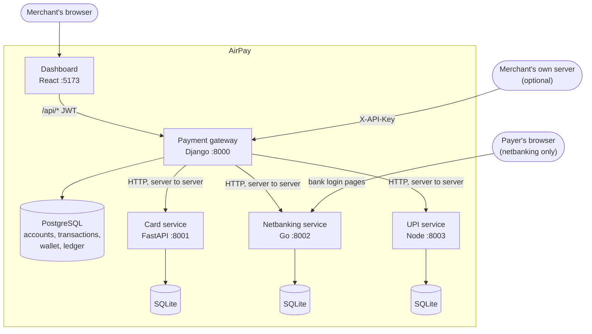
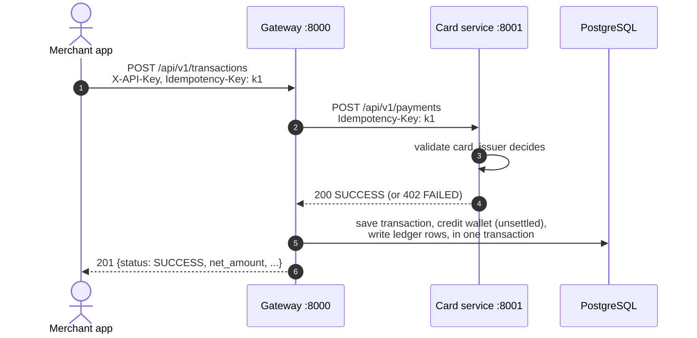
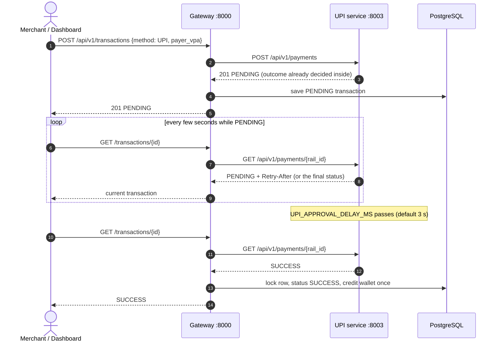
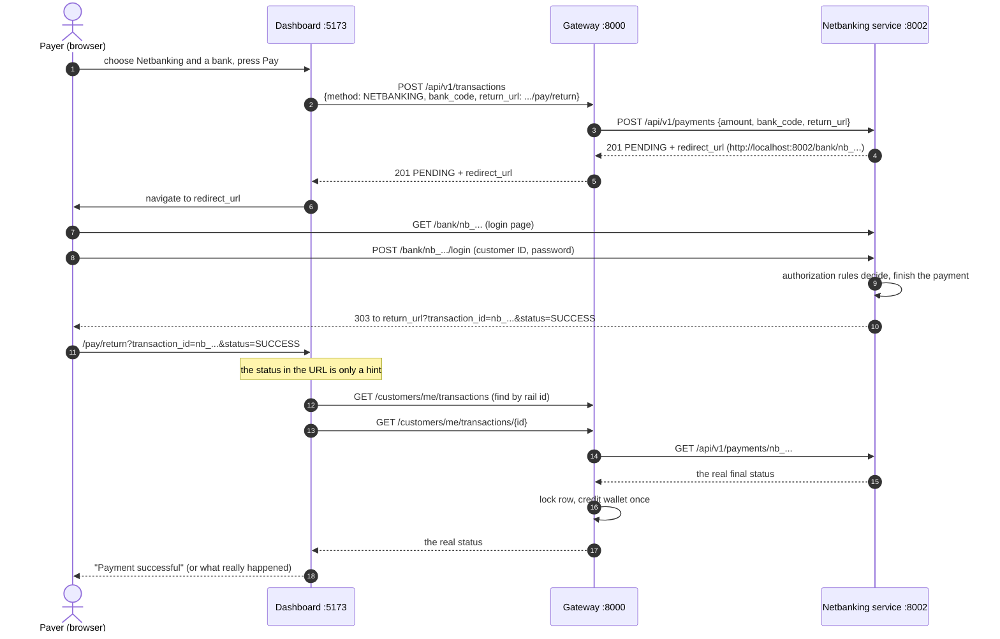
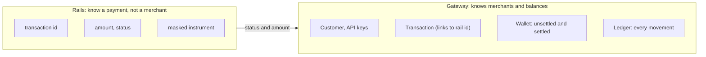
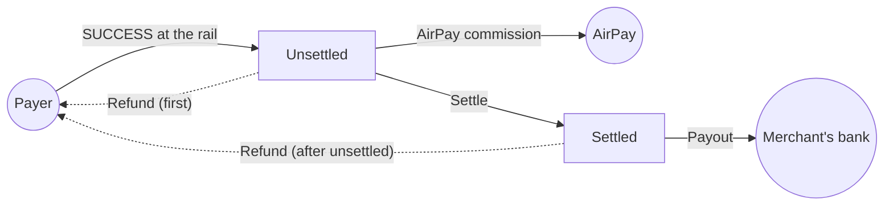
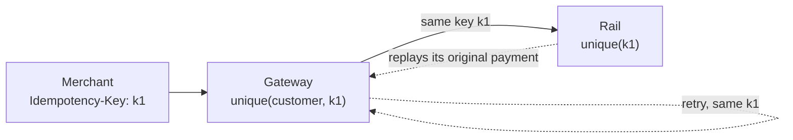

# AirPay

A small payment platform, built as five cooperating programs. A merchant signs up, takes payments by
card, UPI or netbanking, sees them on a dashboard, and moves the money to their bank. Refunds send
money back to a payer.

All three payment *rails* are mocks, so nothing here moves real money. The point is the **shape of the
system**: how a gateway routes to different kinds of payment services, and how they stay consistent.

This file is about **how the services interact**. Each service has its own README (how to use it) and
`HIGH_LEVEL_DESIGN.md` (how it is built and why).

## The services

| Service | Role | Tech | Port | Own storage | Docs |
| --- | --- | --- | --- | --- | --- |
| **Payment gateway** | The front door and book of record: accounts, API keys, routing, wallet, ledger, settlement, payouts, refunds | Python, Django, DRF | 8000 | PostgreSQL (SQLite for tests) | [README](payment_gateway_django/README.md) · [Design](payment_gateway_django/HIGH_LEVEL_DESIGN.md) |
| **Card service** | Mock card network and issuer. Answers at once | Python, FastAPI | 8001 | SQLite | [README](card_payment_service/README.md) · [Design](card_payment_service/HIGH_LEVEL_DESIGN.md) |
| **Netbanking service** | Mock banks, including the login pages the customer sees | Go | 8002 | SQLite | [README](netbanking_support/README.md) · [Design](netbanking_support/HIGH_LEVEL_DESIGN.md) |
| **UPI service** | Mock UPI collect requests. Resolves a few seconds later | Node, TypeScript, Express | 8003 | SQLite | [README](upi_payment_service/README.md) · [Design](upi_payment_service/HIGH_LEVEL_DESIGN.md) |
| **Dashboard** | The merchant's web app | React, TypeScript, Vite | 5173 | none (browser only) | [README](airpay_dashboard/README.md) |

## The big picture



Three ideas shape everything below:

1. **The gateway is the only door.** Browsers and merchants talk to the gateway. Only the gateway talks
   to the rails. The rails never call the gateway, and never call each other.
2. **Each service owns its own data.** There is no shared database. A rail's payment and the gateway's
   transaction are two records, linked by the rail's transaction ID.
3. **The gateway decides nothing about whether a payment is good.** The rail answers; the gateway
   records the answer and moves money accordingly.

## Who may call whom

| Caller | Callee | How it authenticates | What for |
| --- | --- | --- | --- |
| Dashboard (browser) | Gateway | **JWT** (`Authorization: Bearer`) | Account, balance, settle, payouts, refunds, view payments |
| Merchant's server | Gateway | **API key** (`X-API-Key`) | Create and read payments |
| Gateway | Card, UPI, Netbanking | **None** (private network) | Start a payment, ask where it is |
| Payer's browser | Netbanking | None (the payment ID is in the URL) | The bank login page |
| Anything | Rails, directly | Not intended | Rails are internal |
| Rails | Gateway | **Never happens** | There are no webhooks |

The split between JWT and API key is deliberate. A key that can charge cards **cannot** pay out or
refund, so a leaked key cannot drain a wallet. Details are in the
[gateway design](payment_gateway_django/HIGH_LEVEL_DESIGN.md#4-who-is-calling-two-credentials).

## One contract, four services

The services were built to look alike, so the gateway's adapters stay thin and the dashboard needs one
way to read errors.

| Convention | Rule |
| --- | --- |
| Paths | `/api/v1/...`, plus `/health` |
| Field names | `snake_case` |
| Amounts | Strings in rupees with two decimals, such as `"1500.50"`. Inside every service they are whole paise, never floats |
| Success | `{"success": true, "data": {...}}` (the gateway returns the object directly) |
| Error | `{"success": false, "message": "...", "errors": [{"field": "...", "message": "..."}]}` |
| Validation | HTTP `400`, with every field problem listed at once |
| Retries | `Idempotency-Key` header: same key and body returns the original, a different body returns `409` |
| Replay marker | Rails add `Idempotent-Replayed: true` to a replayed answer |
| IDs | Rails: `txn_<uuid>` (card, UPI) and `nb_<uuid>` (netbanking). Gateway: plain UUID |
| Documentation | Every service serves `/docs` and `/openapi.json`, and commits the same file |

## How a payment gets through the system

The three rails behave very differently. That difference is what the gateway hides.

| | Card | UPI | Netbanking |
| --- | --- | --- | --- |
| **Answer arrives** | In the same HTTP call | A few seconds later | When the customer finishes at the bank |
| **First status** | `SUCCESS` or `FAILED` | `PENDING` | `PENDING` |
| **Customer involved?** | No | Approves in their UPI app (simulated) | Leaves the site, logs in at the bank, comes back |
| **Gateway learns the result by** | The create response | Polling the rail | Polling the rail |
| **Final statuses** | `SUCCESS`, `FAILED` | `SUCCESS`, `FAILED`, `EXPIRED` | `SUCCESS`, `FAILED`, `CANCELLED`, `EXPIRED` |
| **Extra field** | | | `redirect_url` |

### Card: one round trip



A decline arrives as `402` from the card service. The gateway treats it as a normal result: the
transaction is saved as `FAILED`, the merchant gets `201`, and the wallet is untouched.

### UPI: create, then poll



The UPI service runs no timers. It stores the outcome at creation and simply reveals it once the clock
passes `resolvesAt`.

### Netbanking: the customer leaves and returns

This is the only flow where a **browser moves between services**.



Two rules keep this safe:

- **Never trust the redirect.** The payer's browser carries the `status` in the URL, so the payer can
  edit it. The dashboard shows what the **gateway** says, after the gateway asked the rail
  server-to-server. If the two differ, the page says so.
- **Coming back is optional.** If the payer closes the tab, the same poll later still returns the
  final answer, including `EXPIRED`.

`redirect_url` is built from the netbanking service's `NETBANKING_BASE_URL`. It has to be an address
the **payer's browser** can reach, not just the gateway.

## Money: who knows what

Each service knows only its own part. The gateway is the only one that knows about *merchants and
money*.



When a payment succeeds, only the gateway moves money:



Settlement, payouts and refunds happen **entirely inside the gateway**. The rails only know about
*collecting*. They have no payout or refund endpoint, so the gateway's own mock processors decide those
outcomes (an amount ending in 99 paise is declined, and a payout to an account ending in `0000` fails).

## Idempotency across services

An `Idempotency-Key` is passed all the way down, so a retry anywhere in the chain cannot charge twice.



| Retry happens at | What stops a double charge |
| --- | --- |
| Merchant to gateway | The gateway finds `(customer, key)` and returns the stored transaction |
| Gateway to rail (gateway crashed or timed out) | The rail finds the key and replays its original payment |
| Two requests at the same instant | A unique constraint in each database lets only one insert win |
| Same key, different request | A fingerprint mismatch returns `409` |

## When something goes wrong

| What fails | What the merchant sees | What happens to money |
| --- | --- | --- |
| A rail is down or times out (10 s) | `503` from the gateway | Nothing saved, nothing credited |
| Card declined | `201`, status `FAILED` | Nothing credited |
| Customer cancels at the bank | Status `CANCELLED` | Nothing credited |
| Payer never answers (UPI or netbanking) | Status `EXPIRED` after the timeout | Nothing credited |
| Rail reports a different amount | Status `FAILED` | Nothing credited |
| Gateway crashes after the rail approved | A retry with the **same key** recovers it | Credited once, on the retry |
| Two polls learn `SUCCESS` together | Same transaction both times | Credited once (row lock plus `credited_at`) |
| Payout declined by the bank | Payout `FAILED` | Settled balance restored |
| Refund, but money already paid out | `400` | Nothing changes |

### Rail status to gateway status

The gateway copies the rail's final status unchanged, so both sides use the same words.

| Rail reports | Gateway stores | Wallet |
| --- | --- | --- |
| `SUCCESS` | `SUCCESS` | Credited, minus commission |
| `FAILED` | `FAILED` | Untouched |
| `PENDING` | `PENDING` | Untouched |
| `EXPIRED` (UPI, netbanking) | `EXPIRED` | Untouched |
| `CANCELLED` (netbanking) | `CANCELLED` | Untouched |

## What is *not* in the design

These are the honest gaps. Each is explained in the relevant design document.

- **No webhooks.** The rails never call the gateway. A `PENDING` payment is only updated when someone
  reads it, so a payment nobody looks at stays `PENDING` here. A reconciliation job or rail webhooks
  would fix it.
- **No authentication between the gateway and the rails.** They trust the network. Do not expose ports
  8001 to 8003 publicly.
- **No refund or payout on the rails.** Those are mocks inside the gateway.
- **A small crash window on create.** The rail is called before the gateway saves its own row. The
  `Idempotency-Key` makes it recoverable.
- **SQLite for each rail** is one file on one host. Fine for a mock, not for a cluster.

## Running everything

You need `uv` (Python), Go 1.26+, Node 22.13+, and Docker (for PostgreSQL, or the gateway falls back
to SQLite).

```bash
./startup.sh        # starts the card, netbanking, UPI services and the gateway
./stop.sh           # stops them by port
```

`startup.sh` starts the **four backend services**. The dashboard is separate:

```bash
cd airpay_dashboard
npm install
npm run dev         # http://localhost:5173, forwards /api/* to the gateway
```

| Open | What you get |
| --- | --- |
| http://localhost:5173 | The dashboard |
| http://localhost:8000/api/docs/ | Gateway Swagger UI (see its README for the exact path) |
| http://localhost:8001/docs | Card service docs |
| http://localhost:8002/docs | Netbanking service docs |
| http://localhost:8003/docs | UPI service docs |

### How the gateway finds the rails

By environment variable, with these defaults:

| Variable | Default |
| --- | --- |
| `CARD_PAYMENT_URL` | `http://localhost:8001` |
| `NETBANKING_URL` | `http://localhost:8002` |
| `UPI_PAYMENT_URL` | `http://localhost:8003` |
| `RAIL_TIMEOUT_SECONDS` | `10` |

If you start a rail on another port or host, set the matching variable for the gateway. For netbanking
also set `NETBANKING_BASE_URL` on the netbanking service, so the `redirect_url` it hands back is an
address the payer's browser can open.

## Test inputs, by rail

| Rail | Input | Result |
| --- | --- | --- |
| Card | `4111111111111111`, CVV `123` | Approved |
| Card | `4111110000000070` | Declined: insufficient funds |
| Card | `4111110000000088` | Declined by issuer |
| Card | CVV `000` | Declined: incorrect CVV |
| UPI | `jane.doe@okaxis` | `SUCCESS` after about 3 s |
| UPI | `insufficient.funds@okaxis` | `FAILED`, `INSUFFICIENT_FUNDS` |
| UPI | `declined@ybl` | `FAILED`, `PAYER_DECLINED` |
| UPI | `expired.user@paytm` | `EXPIRED` after the full timeout |
| Netbanking | Any customer ID, any password except `wrong` | `SUCCESS` |
| Netbanking | Customer ID `declined`, `insufficient`, `timeout`, `locked`, `limit` | `FAILED` |
| Netbanking | Press Cancel | `CANCELLED` |
| Netbanking | Bank `BKID` | `503`, the bank is down |
| Refund | An amount ending in `.99` | Declined by the mock bank, no money moves |
| Payout | Account number ending `0000`, or IFSC starting `FAIL` | Declined, balance restored |

## Repository layout

```
AirPay/
  README.md                       this file: how the services interact
  startup.sh, stop.sh             start and stop the four backend services
  payment_gateway_django/         the gateway           README + HIGH_LEVEL_DESIGN
  card_payment_service/           card rail             README + HIGH_LEVEL_DESIGN
  netbanking_support/             netbanking rail       README + HIGH_LEVEL_DESIGN
  upi_payment_service/            UPI rail              README + HIGH_LEVEL_DESIGN
  airpay_dashboard/               the merchant web app  README
```

## Where to read next

1. **New to the system?** Read this file, then the [gateway design](payment_gateway_django/HIGH_LEVEL_DESIGN.md).
2. **Adding a payment method?** Read how a rail looks in any rail design, then
   [`payments/rails`](payment_gateway_django/payments/rails) in the gateway. A new rail is one service
   plus one adapter that implements `create` and `fetch`.
3. **Changing money logic?** Read the gateway design's
   [money section](payment_gateway_django/HIGH_LEVEL_DESIGN.md#8-money-one-wallet-one-ledger). Balances
   change in exactly one file, `payments/wallet.py`.
