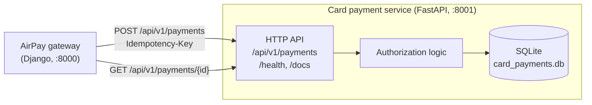
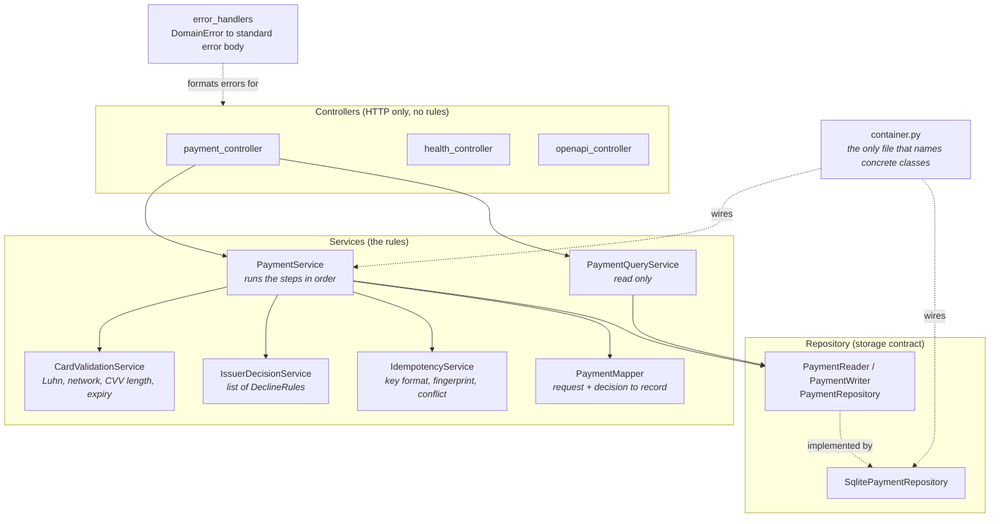
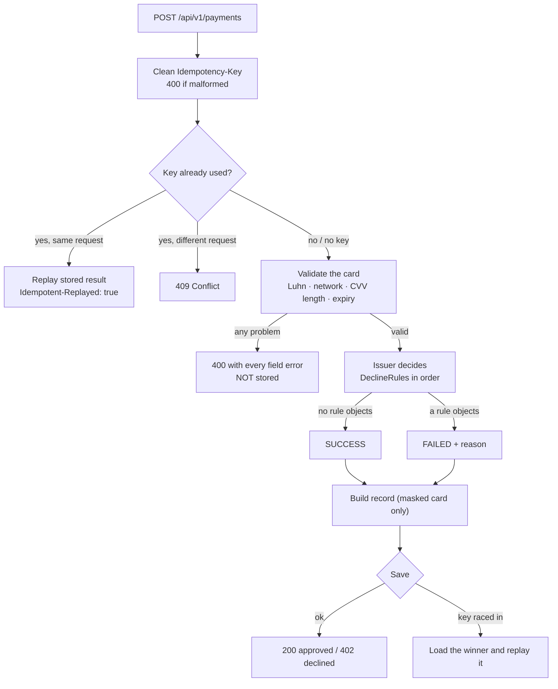
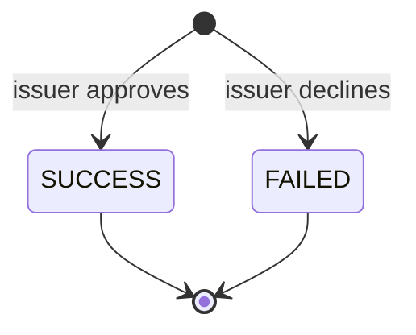
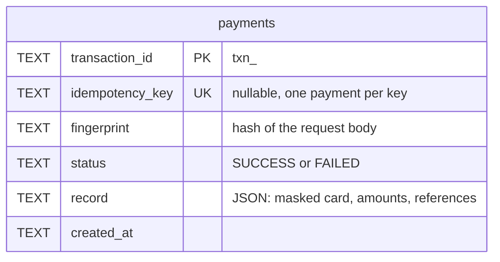

# Card Payment Service: High-Level Design

This document explains how the service is built and why. For endpoints, request bodies and
test cards, see the [README](README.md). For how this service fits with the others, see the
[AirPay system README](../README.md).

## 1. What it is

A **mock card network and issuer**. The AirPay gateway sends it a card and an amount. It checks
that the card is plausible, decides whether the "issuer" approves, and remembers the result.

It is **synchronous**: a card authorization is answered in the same HTTP call. That is the main
difference from the UPI and netbanking services, where the customer has to do something and the
answer arrives later.

It is a mock. No real network is contacted, no money moves, and real card numbers must not be sent.

## 2. Where it sits

Only the gateway calls this service. Customers and merchants never reach it directly.

## 3. How the code is layered

A request goes through three layers. Each layer only knows the one below it, and only through an
abstraction.

| Layer | Job | Must not |
| --- | --- | --- |
| Controller | Read the request, call one service, build the response. | Hold business rules or catch errors. |
| Service | Validation, the issuer decision, idempotency. `PaymentService` only coordinates. | Know about HTTP or SQLite. |
| Repository | Save and load a payment. | Know about cards or rules. |

`container.py` is the **composition root**. It is the one place that decides "use SQLite" or "use
these decline rules". Tests replace pieces through `app.dependency_overrides`.

## 4. The authorization pipeline

`PaymentService.create` is a fixed pipeline. It makes no decisions itself; each step is a class
that is passed in.

Things worth noticing:

- **A decline is a result, not an error.** It is saved and returned with `402`. A validation
  failure is a bad request: it returns `400` and is *not* saved, so a corrected retry can reuse the
  same `Idempotency-Key`.
- **Validation reports every problem at once**, not just the first, so a client can fix a form in
  one round trip.
- **Replay skips validation.** If the key was already used, the stored answer is returned without
  checking the card again.

### The mock issuer

The issuer is a list of `DeclineRule` objects checked in order. The first rule that returns a reason
declines the payment. If none does, the payment succeeds.

| Rule | Behaviour |
| --- | --- |
| `IncorrectCvvRule` | A CVV of all zeros is declined with `Incorrect CVV`. |
| `CardNumberScenarioRule` | The digit before the Luhn check digit picks a scenario: `7` insufficient funds, `8` declined, `9` network timeout. Anything else approves. |

This is why a tester can choose an outcome just by choosing a card number.

## 5. A payment's life

There is almost nothing to show, and that is the design.

There is no `PENDING` state. The answer is known when the payment is created and never changes.
That is why the gateway can credit a merchant's wallet in the same request for a card, and never
has to poll this service for a result.

## 6. Data

One table. The whole payment is stored as JSON in `record`; the other columns exist so the database
can enforce rules and find rows.

- **Only a masked card is stored**: network, type, last four digits, holder name, expiry. The full
  card number and CVV are never written to disk.
- The **unique index on `idempotency_key`** is what makes "one key, one payment" true even when two
  requests with the same key arrive at the same instant on different workers. The loser gets a
  duplicate-key error, loads the winner, and replays it.
- The file runs in **WAL mode**, so readers and a writer work together, and several uvicorn workers
  can share one database.

## 7. Design approach and why

| Decision | Why |
| --- | --- |
| **Controller, service, repository layers** | Each part changes for one reason. Swapping the database touches one class. Changing a rule touches one class. |
| **Rules as a list (`DeclineRule`)** | Open/closed. A new decline scenario is a new class added in `container.py`. `IssuerDecisionService` never changes. |
| **Networks as data (`NetworkProfile`)** | A new card network is a new profile (digit counts, prefixes, CVV length), not new code paths. |
| **`PaymentReader` and `PaymentWriter` split** | The query service takes only a reader, so it cannot write by mistake. |
| **Composition root** | Dependencies are visible in one file. Tests swap them without patching. |
| **Unique index for idempotency** | An in-memory "seen keys" set breaks with more than one worker. The database is the one thing all workers share. |
| **One contract test, two repositories** | `test_payment_repository.py` runs the same checks against SQLite and an in-memory fake. If both pass, either can stand in for the other. |
| **Own error body, `400` not `422`** | Every AirPay service returns `{success, message, errors[{field,message}]}`, so the gateway has one error format to parse. FastAPI's default `422` is replaced and the spec says so. |
| **OpenAPI spec generated and checked** | `openapi.json` is committed and a test fails if it is stale, so the published contract cannot drift from the code. |

## 8. Failure behaviour

| Situation | What happens |
| --- | --- |
| Invalid card or body | `400`, every field error listed, nothing stored. |
| Issuer decline | `402`, stored, replayable. |
| Same key, same body | Original result, `Idempotent-Replayed: true`. |
| Same key, different body | `409`. |
| Two simultaneous requests, same key | One payment is created. The other replays it. |
| Process restarts | Payments and idempotency keys survive. They are in the SQLite file. |
| Unexpected exception | The error handler returns the standard error body with `500`. |

## 9. Limits

- **It is a mock.** The issuer decides from the card number and CVV. There is no balance, no fraud
  check, no 3-D Secure, and no refund or capture.
- **Authentication:** there is none. The service trusts its network, so it must not be exposed
  publicly. The gateway is the only intended caller.
- **The request fingerprint** is an unsalted SHA-256 of the request body, which includes the card
  number. It lets the service tell a retry from a different request, but a hash of a low-entropy
  value like a card number can be brute-forced. For a mock this is acceptable. A real service should
  use a keyed hash (HMAC) or hash only non-sensitive fields.
- **SQLite** is one file on one machine. It suits a mock and a few workers on one host, not a
  cluster.
