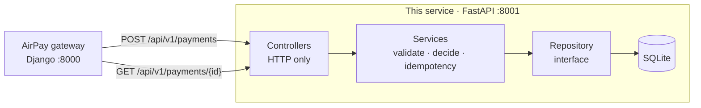

# Card Payment Service

Mock card network for the AirPay payment gateway. The Django app sends card details here; this service identifies the network and authorizes the payment.

It speaks for Visa, Mastercard, Diners, American Express, and RuPay. No real network is contacted. Do not send real card numbers.

How it is built, and why: [HIGH_LEVEL_DESIGN.md](HIGH_LEVEL_DESIGN.md). How it talks to the other AirPay services: [system README](../README.md).

## Run

```bash
uv sync
uv run uvicorn app.main:app --reload --port 8001
```

To use several workers, drop `--reload` and add `--workers 4`. All workers share the same database, so idempotency keys and `GET` lookups behave the same on every worker.

## High-level design

A card authorization is **synchronous**: the issuer's answer comes back in the same HTTP call. That is the whole difference from UPI and netbanking, where the customer has to do something and the result arrives later.



**How the design is approached.** Each request goes through three layers, and each layer only knows the one below it.

- **Controllers** read the HTTP request and write the response. They hold no rules and catch no errors.
- **Services** own the rules, one class each: card validation, the issuer's decline list, idempotency, and a coordinator (`PaymentService`) that only runs them in order.
- **Repository** is an interface. SQLite is one implementation. Tests run the same checks against an in-memory fake, so either can stand in for the other.

A new decline scenario is a new `DeclineRule`. A new card network is a new `NetworkProfile`. Neither change touches existing classes. `container.py` is the only file that names concrete types.

A decline is a **result** (`402`, stored, replayable), not an error. A validation failure is a **bad request** (`400`, not stored), so a corrected retry can reuse the same `Idempotency-Key`.

The diagrams, the pipeline, the data model and the trade-offs are in [HIGH_LEVEL_DESIGN.md](HIGH_LEVEL_DESIGN.md).

## Architecture

A request passes through three layers. Each only knows the one below it, through an abstraction.

| Layer | Files | Responsibility |
| --- | --- | --- |
| Controller | `controllers/payment_controller.py`, `health_controller.py` | Read the request, call a service, build the response. No business rules and no try/except. |
| Service | `services/payment_service.py` | Runs the steps in order. Makes no decisions itself. |
| | `services/card_validation_service.py` | Luhn check, network match, CVV length, expiry. |
| | `services/issuer_decision_service.py` | Approve or decline, using a list of `DeclineRule`s. |
| | `services/idempotency_service.py` | `Idempotency-Key` format, request fingerprint, conflict check. |
| | `services/payment_query_service.py` | Look up a stored payment. Read-only. |
| Repository | `repositories/payment_repository.py` | The contract: `PaymentReader`, `PaymentWriter`, `PaymentRepository`. |
| | `repositories/sqlite_payment_repository.py` | The SQLite implementation. |
| Model | `models.py` | `PaymentRecord`, `CardSummary`. |
| Serializer | `schemas.py` | Request and response shapes. |
| Mapper | `mappers.py` | Builds a `PaymentRecord` from a request and a decision. |
| Error handler | `error_handlers.py`, `exceptions.py` | Turns every error into the standard error response. |
| Wiring | `container.py` | The one place that picks concrete classes. |

### SOLID

| Principle | How it shows up |
| --- | --- |
| Single Responsibility | Validation, the issuer decision, idempotency, record building, and storage are separate classes. `PaymentService` only coordinates them. |
| Open/Closed | A new decline scenario is a new `DeclineRule`. A new network is a new `NetworkProfile`. A new error is a new `DomainError` subclass. None of them touch existing code. |
| Liskov Substitution | `tests/test_payment_repository.py` runs one set of checks against both `SqlitePaymentRepository` and an in-memory fake. Any repository that passes can replace another. |
| Interface Segregation | `PaymentReader` and `PaymentWriter` are separate. `PaymentQueryService` takes only a reader, so it cannot write. |
| Dependency Inversion | Services receive a `PaymentRepository`, not SQLite. Controllers receive services through FastAPI `Depends`. `container.py` is the only file that names concrete classes, and tests swap them with `app.dependency_overrides`. |

To change the database, implement `PaymentRepository` and return it from `get_payment_repository` in `container.py`.

## Storage

Payments are saved in a SQLite file, so they survive restarts. SQLite is part of Python, so there is nothing extra to install or run.

| Setting | Default |
| --- | --- |
| `CARD_PAYMENT_DB` | `card_payments.db` in this folder |

```bash
CARD_PAYMENT_DB=/tmp/airpay_cards.db uv run uvicorn app.main:app --port 8001
```

Delete the file to start clean. The table is created on startup, so there are no migrations.

Only the masked card summary is stored: network, card type, last four digits, holder name, and expiry. The full card number and CVV are never written to disk.

A unique index on the idempotency key makes sure one key creates one payment, even if two requests with the same key arrive at the same moment on different workers.

## API spec (OpenAPI 3.1)

| What | Where |
| --- | --- |
| Swagger UI | [http://localhost:8001/docs](http://localhost:8001/docs) |
| ReDoc | [http://localhost:8001/redoc](http://localhost:8001/redoc) |
| Live spec | [http://localhost:8001/openapi](http://localhost:8001/openapi), same document as [`/openapi.json`](http://localhost:8001/openapi.json) |
| Committed spec | `openapi.json` |

The committed `openapi.json` can be fed to a client generator or imported into Postman. Operation ids are `createPayment`, `getPayment`, and `getHealth`.

After changing a route or model, regenerate it:

```bash
uv run python scripts/export_openapi.py
```

`uv run pytest` fails if `openapi.json` is out of date.

Invalid requests return `400` with the service's own error body, not FastAPI's default `422`, and the spec documents it that way.

## Authorize a payment

`POST /api/v1/payments`

```json
{
  "amount": "1500.50",
  "currency": "INR",
  "card_type": "credit",
  "card": {
    "number": "4111111111111111",
    "expiry_month": 12,
    "expiry_year": 2030,
    "cvv": "123",
    "holder_name": "Jane Doe"
  },
  "reference": "order_1001"
}
```

- `amount` is in rupees, with at most 2 decimal places. A string (`"1500.50"`) or a JSON number (`1500.50`) is accepted. The response always returns a 2-decimal string.
- `currency` is `INR`.
- `card_type` is `credit` or `debit`.
- `card.number` is 13–19 digits. Spaces and dashes are ignored.
- `cvv` is 3 digits, or 4 digits for American Express.
- `reference` is optional. Use it for your own order id.
- Send `Idempotency-Key` to safely retry. The same key and body return the original result, with header `Idempotent-Replayed: true`. The same key with a different body returns `409`. Validation failures are not stored, so a corrected retry can reuse the key.

Approved payments return `200`. Declines return `402`. Both include a `transaction_id`. The full card number and CVV are never stored or returned.

```json
{
  "success": true,
  "data": {
    "transaction_id": "txn_8f0c1c2e-1b4a-4e5d-9c3a-6b7d8e9f0a1b",
    "status": "SUCCESS",
    "amount": "1500.50",
    "currency": "INR",
    "card": {
      "network": "visa",
      "card_type": "credit",
      "last4": "1111",
      "holder_name": "Jane Doe",
      "expiry_month": 12,
      "expiry_year": 2030
    },
    "authorization_code": "A1B2C3",
    "network_reference": "123456789012",
    "reference": "order_1001",
    "created_at": "2026-10-18T12:00:00.000000Z",
    "processed_at": "2026-10-18T12:00:00.000000Z"
  }
}
```

A decline uses the same `data` shape with `"success": false`, `"status": "FAILED"`, and `failure_reason`. `authorization_code` is omitted.

Validation errors return `400`:

```json
{
  "success": false,
  "message": "Validation failed",
  "errors": [{ "field": "card.number", "message": "card number failed the Luhn check" }]
}
```

## Fetch a payment

`GET /api/v1/payments/{transaction_id}`

`200` with `"success": true` when the id exists. Read `data.status` for `SUCCESS` or `FAILED`. `404` when the id is unknown.

## How a card is routed

| Network | Digits | Prefix |
| --- | --- | --- |
| American Express | 15 | `34`, `37` |
| Diners | 14 | `300`–`305`, `36`, `38`, `39` |
| Mastercard | 16 | `51`–`55`, `2221`–`2720` |
| RuPay | 16 | `508`, `60`, `65`, `81`, `82` |
| Visa | 13, 16, or 19 | `4` |

The card number must also pass the Luhn check, and the expiry month must not be in the past.

## Mock issuer decision

For a valid card, the digit **before** the Luhn check digit chooses the result:

| Digit | HTTP | Result |
| --- | --- | --- |
| 0–6 | 200 | Approved |
| 7 | 402 | Insufficient funds |
| 8 | 402 | Transaction declined by issuer |
| 9 | 402 | Card network timeout |

A CVV of `000` (or `0000` on American Express) is declined with `Incorrect CVV` before that digit is considered.

| Card | CVV | Result |
| --- | --- | --- |
| `4111111111111111` | `123` | Visa approved |
| `5555555555554444` | `123` | Mastercard approved |
| `2223003122003222` | `123` | Mastercard approved |
| `378282246310005` | `1234` | American Express approved |
| `30569309025904` | `123` | Diners approved |
| `6074840000000015` | `123` | RuPay approved |
| `4111110000000070` | `123` | Insufficient funds |
| `4111110000000088` | `123` | Declined by issuer |
| `4111110000000096` | `123` | Card network timeout |
| `4111111111111111` | `000` | Incorrect CVV |

## Health

`GET /health` returns the service name and the networks it can authorize.
