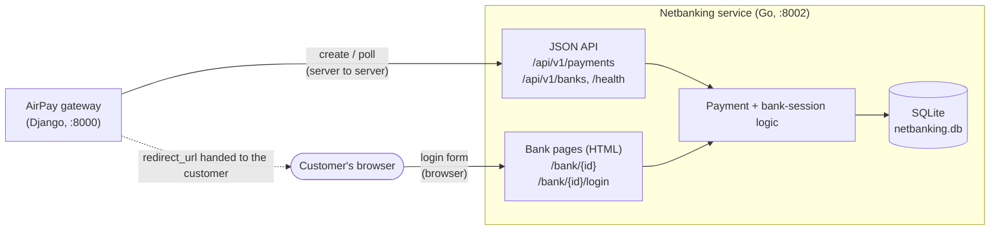
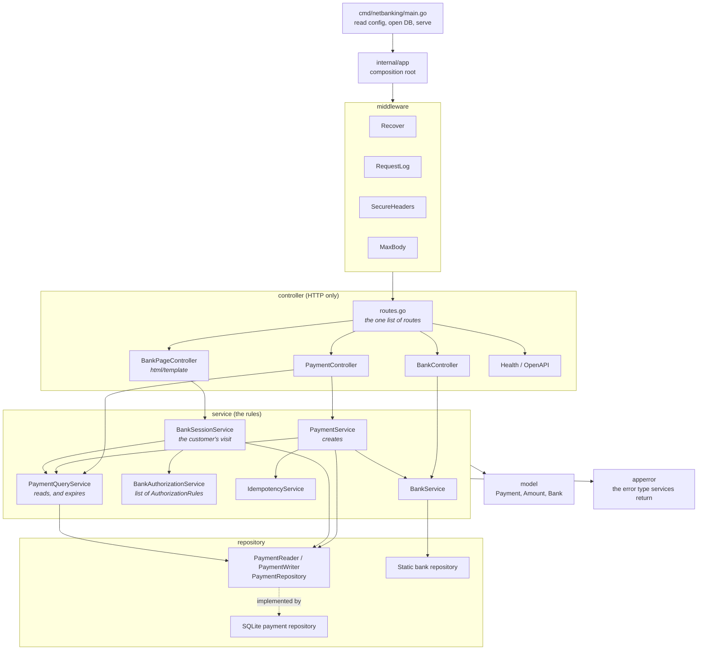
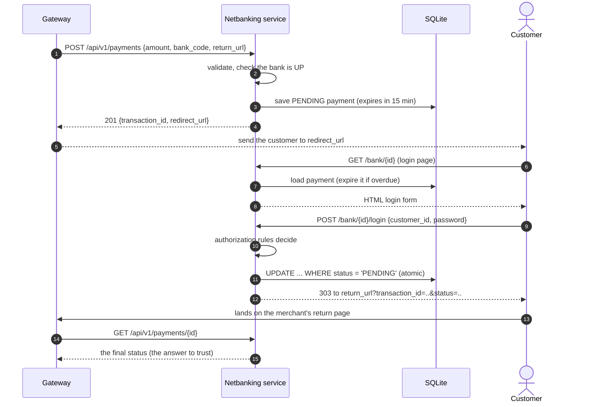
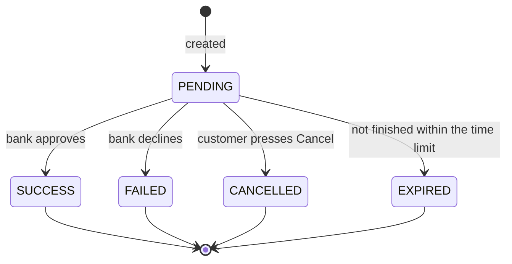
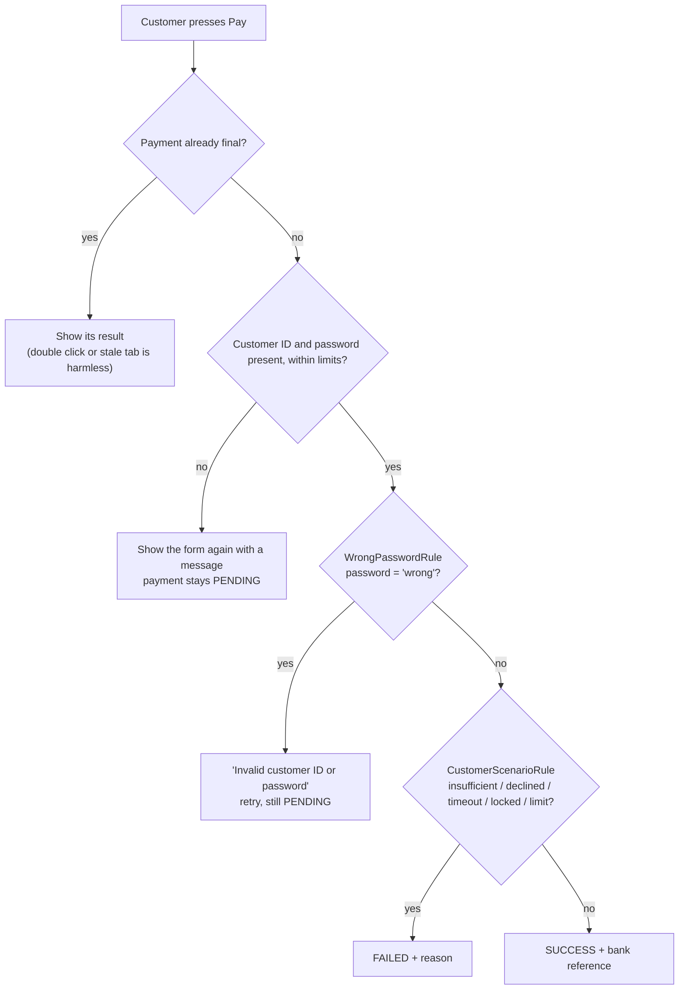
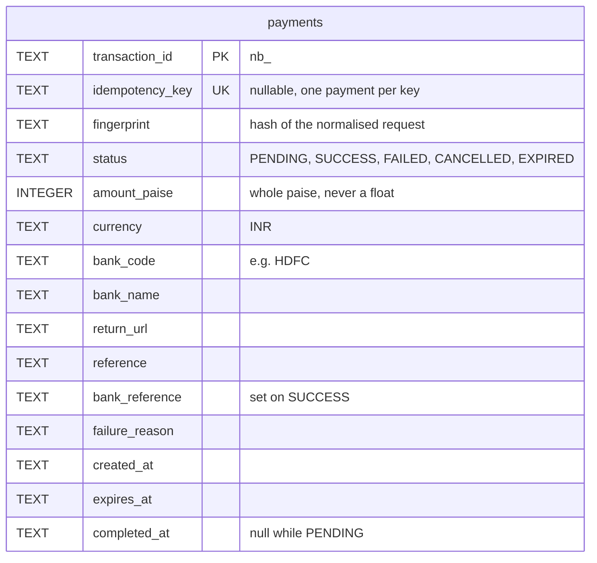

# Netbanking Support: High-Level Design

This document explains how the service is built and why. For endpoints, configuration and test
logins, see the [README](README.md). For how this service fits with the others, see the
[AirPay system README](../README.md).

## 1. What it is

A **mock of Indian banks' netbanking systems**, written in Go. The AirPay gateway starts a payment
here. The *customer* is then sent to a bank login page served by this same service, where they log in
and approve (or cancel). Later the gateway asks how the payment ended.

Netbanking is **redirect-based and asynchronous**. Unlike a card, the customer has to leave the
merchant's site and complete the payment on the bank's site, so this service has two faces:

- a **JSON API** for the gateway, and
- **HTML pages** for the customer's browser.

It moves no money and checks no real credentials.

## 2. Where it sits



The gateway talks to the API. The customer talks to the pages. The two never share a session: the
payment ID in the URL is the only link between them.

## 3. How the code is layered



A controller calls a service, a service calls a repository, and nothing points the other way.
`internal/app` is the only package that names concrete types. Services depend on small interfaces:
`PaymentRepository`, `BankRepository`, `Clock` and `IDGenerator`.

## 4. The full payment journey

This is the part that makes netbanking different. Three parties are involved, and the browser
redirect is the hand-off.



**The `status` in the return URL is only a hint.** The customer's browser carries it, so the customer
can edit it. The gateway must ask the API (step 12) and use *that* answer. The AirPay dashboard's
`/pay/return` page does exactly this.

If the customer never comes back, the same `GET` still gives the final answer, including `EXPIRED`.

## 5. A payment's life



`PENDING` is the only state that can change. Every other state is final.

### Two requests, one winner

Several things can finish a payment at nearly the same time: a login, a cancel, a double click, the
expiry check. They must not overwrite each other. Every transition is one atomic statement:

```sql
UPDATE payments SET status = ?, ... WHERE transaction_id = ? AND status = 'PENDING'
```

If no row changed, someone else already finished it, so the service reads and returns **their**
result. Exactly one request wins, and no locks or transactions are needed in the service.

### Expiry without a background job

Nothing runs in the background. A payment past its deadline is moved to `EXPIRED` **the first time it
is read**, using the same atomic update. Every reader (the API, the bank page, a replayed create)
goes through `PaymentQueryService`, so all of them see the same, current state.

## 6. How the bank decides

The customer ID typed on the login page picks the outcome. `BankAuthorizationService` holds a list of
`AuthorizationRule`s, checked in order. The first rule with an opinion decides. If none does, the
payment is approved.



A wrong password is a **retry**, not a failure: the payment stays `PENDING`. A decline is final.

## 7. Data



Unlike the card and UPI services, the payment is stored as **real columns**, because the status
changes and the `UPDATE ... WHERE status = 'PENDING'` needs a status column to test.

The banks are a **static list** (16 banks, keyed by the first four letters of the IFSC), not a table.
Banks listed in `NETBANKING_DOWN_BANKS` (default `BKID`) are reported as `DOWN`, which makes a
payment to them fail with `503` before anything is created.

**Credentials are never stored or logged.** The password is used once, to ask the authorization
service for a verdict. A test scans the database file and the logs to prove it.

## 8. Design approach and why

| Decision | Why |
| --- | --- |
| **One service, two faces (API and pages)** | The bank page must be on the "bank's" host, and it needs the same payment state as the API. One process and one database keep them consistent. |
| **Atomic `UPDATE ... WHERE status = 'PENDING'`** | Settles every race (login vs cancel vs expiry) in the database, with no locks in the code. |
| **Expiry on read** | No scheduler to run, monitor or lose. Correct after a restart. |
| **Always confirm with the API** | The browser carries the redirect's query string, so it cannot be trusted. The server-to-server `GET` can. |
| **Rules as a list (`AuthorizationRule`)** | A new bank scenario is a new rule passed in at `internal/app`. No existing code changes. |
| **Small interfaces, injected `Clock` and `IDGenerator`** | Tests move time and get fixed IDs. `repotest.Run` runs one set of checks against SQLite and an in-memory fake. |
| **Standard library plus one dependency** | HTTP, templates and logging come from Go itself. The only third-party package is a pure-Go SQLite driver (`modernc.org/sqlite`), so there is no C compiler to install. |
| **`html/template` and no scripts on bank pages** | Every value is escaped for where it lands. Pages send `Content-Security-Policy`, `X-Frame-Options: DENY`, `Referrer-Policy: no-referrer` and `Cache-Control: no-store`. |
| **`return_url` must be absolute `http(s)` with no credentials** | Rules out `javascript:` and `data:` redirect targets, and URLs that disguise the real host. |
| **Credentials only from the POST body** | They never appear in a URL, so they never appear in a log line or a Referer header. |
| **Body limits (1 MiB, forms 64 KiB)** | A caller cannot make the service buffer unbounded input. |
| **Hand-written OpenAPI, tested** | A test checks that the spec describes exactly the routes the server has, with unique operation IDs and resolvable `$ref`s. |
| **Same conventions as the other rails** | `/api/v1`, string amounts, `Idempotency-Key`, `{success, data}` and `{success, message, errors}`, so the gateway adapters stay thin. |

## 9. Failure behaviour

| Situation | What happens |
| --- | --- |
| Bad body, field, or `Idempotency-Key` | `400`, every field problem listed at once. |
| Chosen bank is down | `503`, no payment created. |
| Wrong password | Form shown again, payment stays `PENDING`. |
| Bank declines | `FAILED` with a reason. Final. |
| Customer cancels | `CANCELLED`. Final. |
| Customer abandons the page | `EXPIRED` after the time limit, on the next read. |
| Login after the payment is already final | The existing result is shown. Nothing changes. |
| Same key, same request | Same payment, `200`, `Idempotent-Replayed: true`, in its current state. |
| Same key, different request | `409`. |
| Concurrent creates with one key | Exactly one payment. The database enforces it. |
| Wrong method on a route | `405` with an `Allow` header. |
| Panic in a handler | `Recover` middleware returns an error response instead of dropping the connection. |

## 10. Limits

- **It is a mock.** There is no real bank connection, no real credentials, and no webhook to the
  gateway. The gateway must **poll** or wait for the customer to return.
- **Authentication on the API:** none. The service must sit on a private network. Only the *bank pages*
  are meant to be reached by a browser.
- **`redirect_url` host:** it is built from `NETBANKING_BASE_URL`. If that is not the address the
  customer's browser can reach, the redirect will not work.
- **No refund or reversal.**
- **SQLite** is one file on one host. It fits a mock, not a cluster.
