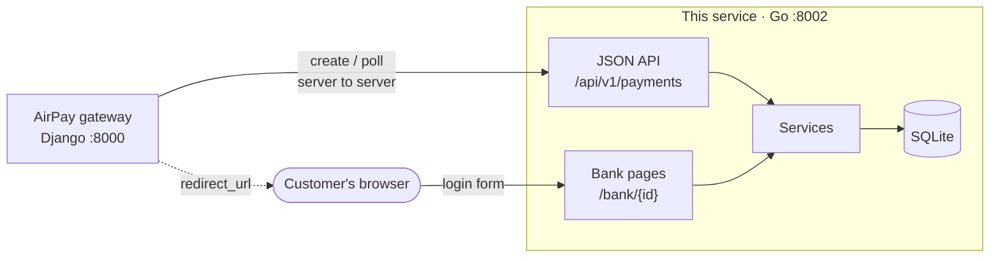

# Netbanking Support (mock)

A mock netbanking service for the AirPay payment gateway, written in Go. It stands in for the
Indian banks' netbanking systems. The gateway starts a payment, sends the customer to a bank
login page, and later asks this service how the payment ended.

It is a mock. It moves no money and checks no real credentials. The outcome is chosen by the
customer ID typed on the login page, so every path can be tested.

How it is built, and why: [HIGH_LEVEL_DESIGN.md](HIGH_LEVEL_DESIGN.md). How it talks to the
other AirPay services: [system README](../README.md).

## High-level design

Netbanking is **redirect-based**. Unlike a card, the customer leaves the merchant's site and
finishes at the bank, so this service has two faces: a JSON API for the gateway, and HTML
pages for the customer's browser.



**How the design is approached.** The gateway talks to the API. The customer talks to the
pages. They share no session: the payment ID in the URL is the only link. The `status` in
the return URL is only a hint (the customer can edit it). The answer to trust is always
`GET /api/v1/payments/{id}`.

A payment is `PENDING` until login, cancel or expiry finishes it. Every transition is one
atomic statement, `UPDATE ... WHERE status = 'PENDING'`, so a double click, a cancel and
an expiry check cannot overwrite each other. Expiry is applied when a payment is **read**,
so there is no background job.

The rest matches the other rails: controllers call services, services call a repository
interface, `internal/app` is the only package that names concrete types, bank outcomes are
a list of `AuthorizationRule`s, and money is whole paise.

The full journey, the state machine, the data model and the security choices (no stored
credentials, escaped templates, `http(s)`-only `return_url`) are in
[HIGH_LEVEL_DESIGN.md](HIGH_LEVEL_DESIGN.md).

## Run

```bash
cd netbanking_support
go run ./cmd/netbanking          # http://localhost:8002
```

Open <http://localhost:8002/docs> for the interactive API documentation. The raw spec is at
`/openapi` and `/openapi.json`, and is also committed as `api/openapi.json`.

```bash
go test -race ./...              # all tests
```

Needs Go 1.26 or newer. There is no other setup. SQLite is built in, with no C compiler needed.

## How a payment works

```
 Django gateway                 Netbanking service                    Customer
      |  POST /api/v1/payments        |                                   |
      |------------------------------>|  creates PENDING payment          |
      |<--- 201 {redirect_url} -------|                                   |
      |  redirect the customer ------------------------------------------>|
      |                               |<--- GET /bank/{id} (login page) --|
      |                               |<--- POST /bank/{id}/login --------|
      |                               |  SUCCESS / FAILED / CANCELLED     |
      |<-- 303 to return_url?transaction_id=..&status=.. (via customer) --|
      |  GET /api/v1/payments/{id}    |                                   |
      |------------------------------>|  the answer to trust              |
```

**Always confirm the outcome with `GET /api/v1/payments/{transaction_id}`.** The query string
on `return_url` is only a hint. The customer can edit it.

A payment is `PENDING` until one of these happens. After that it never changes.

| Status | Meaning |
| --- | --- |
| `SUCCESS` | The bank approved. `bank_reference` is set. |
| `FAILED` | The bank declined. `failure_reason` says why. |
| `CANCELLED` | The customer pressed Cancel. |
| `EXPIRED` | The customer did not finish within the time limit (15 minutes by default). |

## Endpoints

| Method and path | Purpose |
| --- | --- |
| `POST /api/v1/payments` | Start a payment. Returns `201` and a `redirect_url`. |
| `GET /api/v1/payments/{transaction_id}` | Read a payment. |
| `GET /api/v1/banks` | List banks. Optional `?status=UP` or `?status=DOWN`. |
| `GET /health` | Liveness check. |
| `GET /bank/{transaction_id}` | The bank's login page (HTML, for the customer). |
| `POST /bank/{transaction_id}/login` | The login form (HTML, for the customer). |
| `GET /docs`, `/openapi`, `/openapi.json` | Documentation and spec. |

Create request:

```bash
curl -X POST localhost:8002/api/v1/payments \
  -H 'Content-Type: application/json' \
  -H 'Idempotency-Key: order-1001' \
  -d '{"amount": "1500.50", "bank_code": "HDFC",
       "return_url": "https://shop.example.com/return", "reference": "order_1001"}'
```

```json
{
  "success": true,
  "data": {
    "transaction_id": "nb_6d1c...",
    "status": "PENDING",
    "amount": "1500.50",
    "currency": "INR",
    "bank": {"code": "HDFC", "name": "HDFC Bank"},
    "redirect_url": "http://localhost:8002/bank/nb_6d1c...",
    "return_url": "https://shop.example.com/return",
    "reference": "order_1001",
    "created_at": "2026-10-18T12:00:00.000000Z",
    "expires_at": "2026-10-18T12:15:00.000000Z"
  }
}
```

- `amount` is in rupees. Send a string such as `"1500.50"`. A number is accepted too. At most 2
  decimals, above 0, up to 1,00,00,000.00. It is stored as whole paise, never as a float.
- `currency` is optional and can only be `INR`.
- `return_url` must be an absolute `http` or `https` URL with no username or password.
- `reference` is your own order id (letters, digits, `_`, `-`, up to 64). It is optional.
- Unknown JSON fields are rejected, so a typo is an error instead of being ignored.
- `redirect_url` is only present while the payment is `PENDING`.

Errors always look the same:

```json
{"success": false, "message": "Validation failed",
 "errors": [{"field": "bank_code", "message": "bank_code is not a supported bank"}]}
```

| Status | When |
| --- | --- |
| `400` | Bad body, bad field, bad `Idempotency-Key`. Every field problem is reported at once. |
| `404` | Unknown payment or route. |
| `405` | Wrong method. The `Allow` header lists the right ones. |
| `409` | The `Idempotency-Key` was already used for a different request. |
| `413` | Body larger than 1 MiB. |
| `503` | The chosen bank is down. No payment is created. |

### Idempotency

Send an `Idempotency-Key` header (letters, digits, `. _ : -`, up to 255) when creating a payment.
Retrying with the same key and the same request returns the same payment with `200` and an
`Idempotent-Replayed: true` header, showing its current state. The same key with a different
request returns `409`. Concurrent retries create exactly one payment. The database enforces this,
so it also holds across several server processes.

## Test logins

On the bank page, type any customer ID and password. The customer ID picks the outcome
(case-insensitive).

| Customer ID | Result |
| --- | --- |
| anything else | `SUCCESS` |
| `insufficient` | `FAILED`, "Insufficient funds" |
| `declined` | `FAILED`, "Transaction declined by bank" |
| `timeout` | `FAILED`, "Bank server timeout" |
| `locked` | `FAILED`, "Customer account is locked" |
| `limit` | `FAILED`, "Transaction limit exceeded" |

Password `wrong` shows "Invalid customer ID or password." and the customer can try again. It is
checked before the customer ID. Pressing **Cancel** ends the payment as `CANCELLED`.

Bank of India (`BKID`) is reported as down by default, to test the `503` path.

## Banks

`SBIN` State Bank of India, `HDFC` HDFC Bank, `ICIC` ICICI Bank, `UTIB` Axis Bank, `KKBK` Kotak
Mahindra Bank, `PUNB` Punjab National Bank, `BARB` Bank of Baroda, `YESB` Yes Bank, `INDB`
IndusInd Bank, `CNRB` Canara Bank, `UBIN` Union Bank of India, `IDFB` IDFC FIRST Bank, `FDRL`
Federal Bank, `BKID` Bank of India, `IBKL` IDBI Bank, `CBIN` Central Bank of India.

The codes are the first four letters of each bank's IFSC. `GET /api/v1/banks` is the live list.

## Configuration

| Variable | Default | Meaning |
| --- | --- | --- |
| `PORT` | `8002` | Port to listen on. |
| `NETBANKING_BASE_URL` | `http://localhost:<PORT>` | Public address, used to build `redirect_url`. |
| `NETBANKING_DB` | `netbanking.db` | SQLite file. |
| `NETBANKING_PAYMENT_TTL` | `15m` | How long the customer has to pay (1s to 24h). |
| `NETBANKING_DOWN_BANKS` | `BKID` | Comma separated codes reported as down. Set empty for none. |

Invalid values stop the server at startup with a message naming the variable.

## Using it from the Django gateway

1. `POST /api/v1/payments` with the amount, bank, your `return_url` and an `Idempotency-Key`.
2. Redirect the customer to `data.redirect_url`.
3. When the customer lands on your `return_url`, read `transaction_id` from the query, then call
   `GET /api/v1/payments/{transaction_id}`. Use that response and ignore `status` in the query.
4. If the customer never returns, the same `GET` still gives the final answer, including `EXPIRED`.

## Security notes

- The service never stores or logs customer IDs or passwords. Logs hold the path, not the query
  string or body. A test checks the database file and the logs for credentials.
- Credentials are read only from the POST body, never from the URL.
- Bank pages are plain HTML with no scripts. They send `Content-Security-Policy`,
  `X-Frame-Options: DENY`, `Referrer-Policy: no-referrer` and `Cache-Control: no-store`.
  Every value is escaped by `html/template`.
- `return_url` must be `http` or `https`, which rules out `javascript:` and `data:` links.
- Request bodies are limited to 1 MiB, and login forms to 64 KiB.

## Architecture

```
cmd/netbanking/        main: reads config, opens the database, starts the server
api/                   openapi.json, embedded in the binary
internal/
  app/                 composition root: builds and connects everything
  config/              environment settings
  controller/          HTTP: request in, service call, response out. No business rules
  service/             business rules
  repository/          storage: SQLite payments, static bank list
  model/               Payment, Amount, Bank
  middleware/          recover, request log, secure headers, body limit
  apperror/            the error type services return
  testutil/            fakes for tests: clock, ids, in-memory repository
```

A controller calls a service, a service calls a repository, and nothing points the other way.

| Principle | Where |
| --- | --- |
| Single responsibility | One service per job: `PaymentService` creates, `PaymentQueryService` reads and expires, `BankSessionService` runs the customer's session, `BankAuthorizationService` decides the outcome, `IdempotencyService` handles keys. |
| Open/closed | A new bank scenario is a new `AuthorizationRule`, passed in at the composition root. No existing code changes. |
| Liskov | `repotest.Run` runs the same tests against SQLite and the in-memory fake. |
| Interface segregation | `PaymentReader` and `PaymentWriter` are separate. Services take only what they use. |
| Dependency inversion | Services depend on interfaces (`PaymentRepository`, `Clock`, `IDGenerator`, `BankRepository`). Only `internal/app` names concrete types. |

Other choices:

- Payments end through one atomic `UPDATE ... WHERE status = 'PENDING'`. When two requests race,
  exactly one wins, and the other sees the winner's result.
- Expiry is applied when a payment is read, so there is no background job.
- Only the standard library is used for HTTP and templates. The one dependency is the SQLite driver.
- Time and ids come from `Clock` and `IDGenerator`, so tests can move time and get fixed ids.
- `api/openapi.json` is written by hand. A test checks that it describes exactly the routes the
  server has, that operation ids are unique and that every `$ref` resolves.
