# Payment Gateway: High-Level Design

This document explains how the gateway is built and why. For endpoints, configuration and
examples, see the [README](README.md). For how the gateway fits with the three rail services, see
the [AirPay system README](../README.md).

## 1. What it is

The gateway is AirPay's **front door and its book of record**. It does five jobs:

1. **Accounts.** Merchants ("customers") sign up, log in, and manage API keys and bank accounts.
2. **Collecting payments.** It takes a payment request and routes it to the right *rail*: card, UPI
   or netbanking.
3. **Keeping the books.** When a payment succeeds it credits the merchant's wallet, minus AirPay's
   commission, and writes a ledger entry for every movement.
4. **Moving money out.** Settlement (unsettled to settled), bank payouts, and refunds.
5. **Presenting one API.** One error shape, one idempotency rule and one amount format, whatever
   rail is behind a payment.

It does **not** authorize cards, approve UPI requests or log customers in to banks. The rail services
do that. The gateway never decides whether a payment is good, only what to do with the answer.

## 2. Where it sits

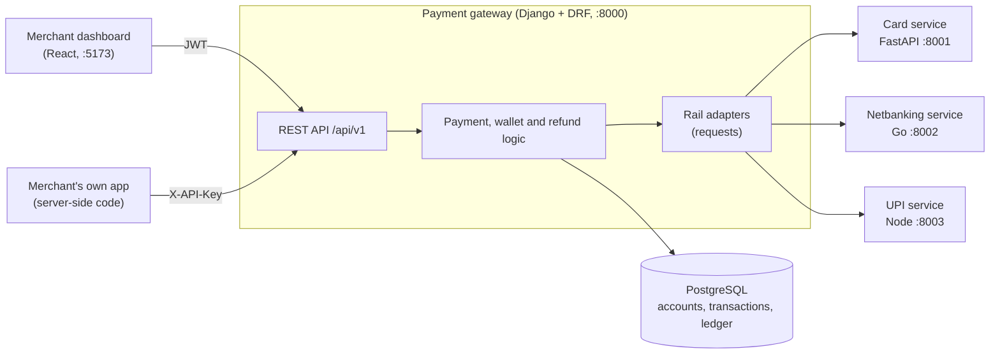

## 3. How the code is organised

Four Django apps. Each feature has its own app and its own `urls.py`.

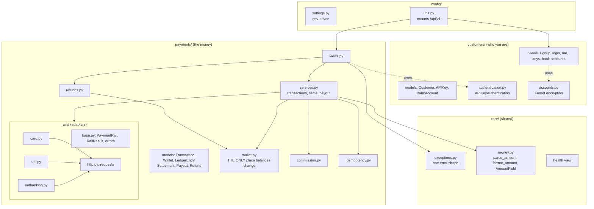

The rule that holds this together: **views are thin, services decide, `wallet.py` is the only code
that changes a balance, and `rails/` is the only code that talks to the outside.**

## 4. Who is calling: two credentials

The gateway has two kinds of caller, and they get two kinds of credential on purpose.

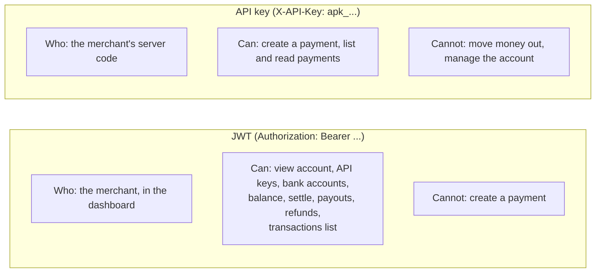

| | JWT | API key |
| --- | --- | --- |
| **Held by** | A person in a browser | A server, in config |
| **Lifetime** | Access 15 min, refresh 7 days, refresh tokens rotate and are blacklisted after use | Up to 365 days, can be revoked at once |
| **Stored** | Nothing (signed) | Only an HMAC of the secret, plus a public prefix for lookup. The secret is shown once. |
| **Allows** | Everything about the account and the money | Taking payments only |
| **Why separate** | An access token cannot be revoked, so it is short-lived and never put in a page that charges cards. | A leaked key can take payments but cannot pay out, refund or read bank details. |

This split is the most important security decision in the gateway. **A key that can charge cards
cannot also move money out.** Refunds are JWT-only for the same reason.

## 5. Rails: one interface, three adapters

The gateway needs the same two things from every rail: *start a payment* and *tell me where it is
now*. That is the whole interface.

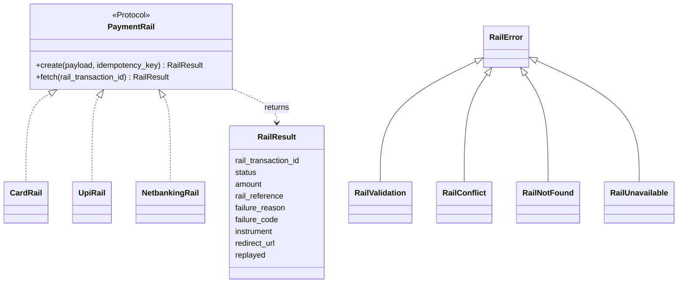

Each adapter does only translation: build the rail's request body from the gateway's fields, call it
through `rails/http.py` (which uses `requests`), and turn the rail's response into a `RailResult`.

| Rail | Sync? | What the adapter maps |
| --- | --- | --- |
| Card | Answers in the same call | `last4`, `network`, `card_type` to `instrument`. `authorization_code` to `rail_reference`. |
| UPI | `PENDING`, resolves in seconds | Payer VPA and failure code. |
| Netbanking | `PENDING` until the customer finishes at the bank | `bank_code`, `bank_name`, **`redirect_url`**. |

### Rail errors become API errors in one place

| Rail says | Gateway raises | Merchant sees |
| --- | --- | --- |
| `400` validation | `RailValidation` | `400` with the rail's field errors, in the standard shape |
| `409` key reused with a different body | `RailConflict` | `409` |
| `404` unknown payment | `RailNotFound` | Treated as "no news": the transaction is returned unchanged |
| Timeout, refused connection, `5xx`, unreadable reply | `RailUnavailable` | `503` |
| `402` (card declined) | *not an error* | A normal `FAILED` transaction |

A decline is a **business result**, not an exception: the transaction is saved as `FAILED` with a
reason, and the call returns `201`.

## 6. Creating a payment

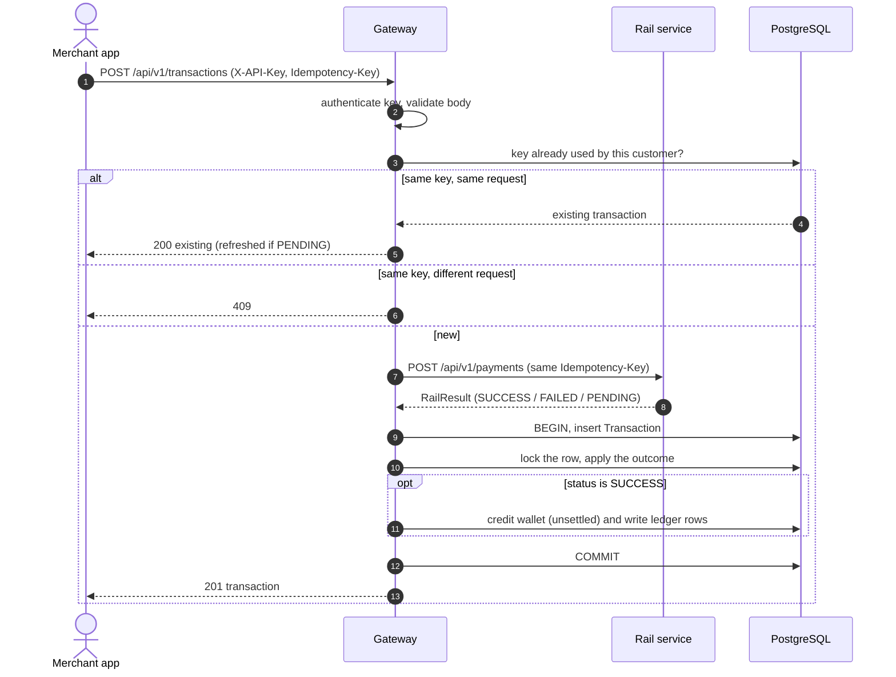

Two details matter:

- **The rail is called before the local row exists, and outside any database transaction.** A slow
  rail never holds a database lock. The cost is described in section 11.
- **The same `Idempotency-Key` is passed to the rail**, so a retry that reaches the rail again gets the
  original rail payment back instead of a second one.

### Pending payments finish later

UPI and netbanking return `PENDING`. The gateway has **no webhook** from the rails, so it learns the
result by asking.

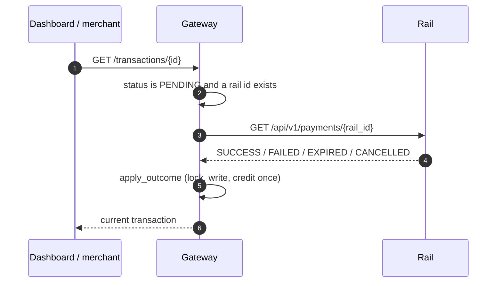

`refresh_transaction` runs on every **detail** read of a `PENDING` payment. The **list** endpoint does
not call the rails, so a long list stays fast and cannot fan out into dozens of rail calls. The
dashboard therefore polls the detail endpoint for anything pending.

## 7. A transaction's life, and crediting exactly once

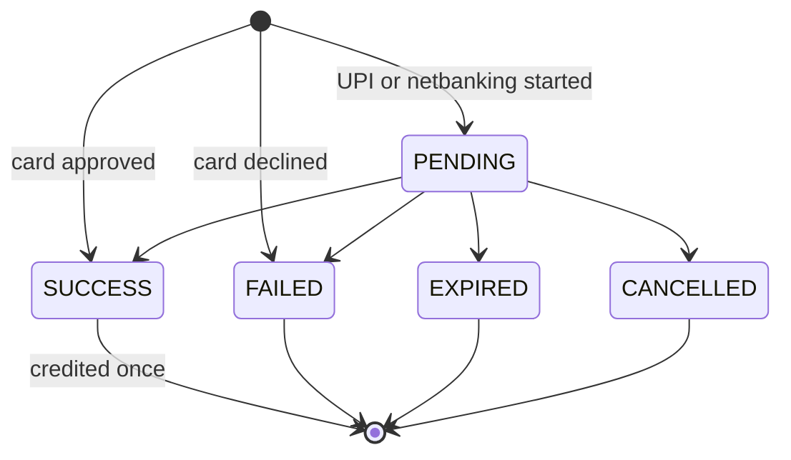

Several requests can learn about the same result at once: a poll, a retry, the dashboard, the
merchant's own check. The wallet must be credited **exactly once**. `apply_outcome` guarantees this:

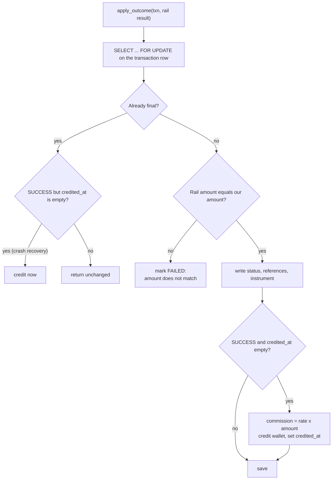

- The **row lock** serializes concurrent callers: the second one waits, then finds a final state.
- **`credited_at`** is the "already paid" marker. A `SUCCESS` with no `credited_at` is credited
  late, which repairs a crash between the status write and the credit.
- The gateway **checks the amount the rail reports** against its own. A mismatch fails the payment
  instead of crediting the wrong sum.

## 8. Money: one wallet, one ledger

All amounts are **integer paise** in the database and rupee strings (`"1500.50"`) in the API, so
floats never touch money. `AmountField` does the conversion at the edge.

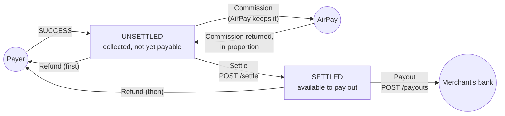

| Movement | Wallet effect | Ledger rows |
| --- | --- | --- |
| Payment succeeds | Unsettled up by amount, then down by commission | `COLLECTION` credit, `COMMISSION` debit |
| Settle | Unsettled down, settled up | `SETTLEMENT` debit and credit |
| Payout | Settled down | `PAYOUT` debit |
| Payout fails | Settled restored | `PAYOUT_REVERSAL` credit |
| Refund | Commission back to unsettled, then refund from unsettled, then from settled | `COMMISSION_REVERSAL` credit, `REFUND` debit(s) |

### The wallet cannot be wrong

- **Single writer.** `payments/wallet.py` is the only code that changes `Wallet`. Every change writes
  a `LedgerEntry` in the same database transaction, under `SELECT ... FOR UPDATE` on the wallet row,
  so two payouts cannot spend the same rupee.
- **Database guards.** `CHECK (unsettled_paise >= 0)` and `CHECK (settled_paise >= 0)` mean a bug in
  the code still cannot create a negative balance.
- **The ledger is the proof.** `ledger_totals()` recomputes both balances from the ledger. Tests
  assert it equals the wallet after every kind of operation.

### Commission

AirPay's fee is worked out **once**, when the wallet is credited, from the method and instrument
(for example credit Visa 1%, Amex 4%, UPI 1%, netbanking 2%, debit 0%). It is stored on the
transaction (`commission_rate_bps`, `commission_paise`), so a later rate change never rewrites
history. Rates live in `payments/commission.py`.

### Refunds

A refund sends money back to a payer from the merchant's wallet:

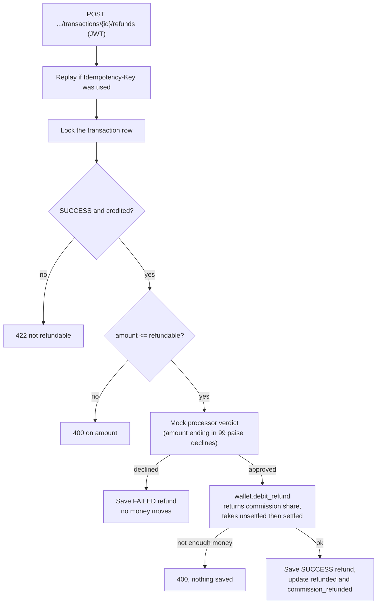

The commission returned is `round(commission x refunded_so_far / amount)` minus what was already
returned, so split refunds add up to **exactly** the commission charged, never a paisa more or less.

## 9. Data

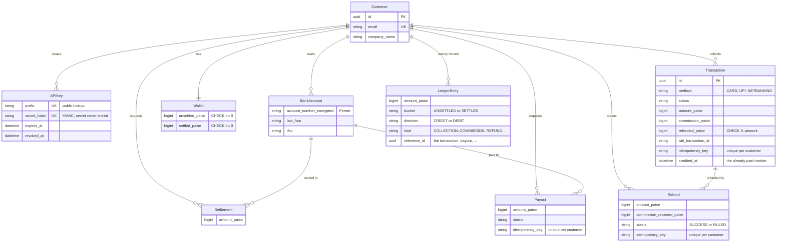

Bank account numbers are **encrypted** (Fernet). The API only ever returns the last four digits and
the IFSC. A transaction keeps only a masked instrument (card `last_four` and network, a VPA, a bank
name), never a full card number or CVV, which go to the card service and nowhere else.

## 10. Idempotency

Payments, payouts and refunds all accept an `Idempotency-Key`, and they all work the same way:

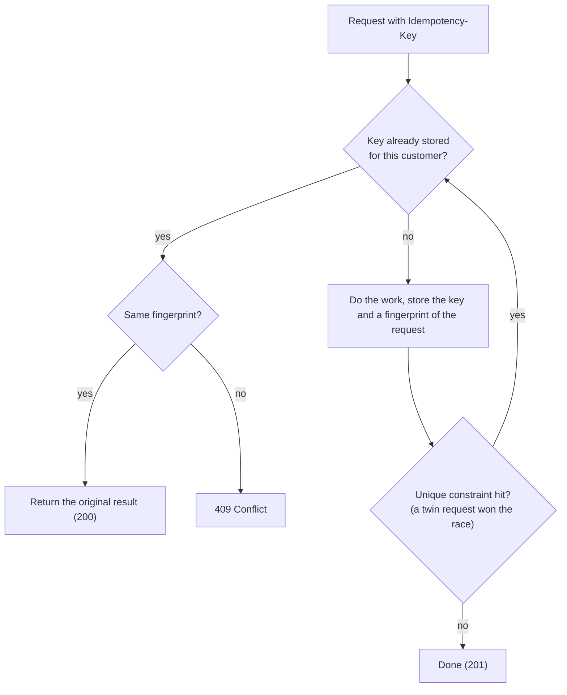

- A **fingerprint** is a SHA-256 of the meaningful fields of the request. It separates a *retry* from a
  *different request that reused a key*.
- A **unique constraint** on `(customer, idempotency_key)` settles races in the database. If two
  identical requests arrive together, one inserts and the other hits the constraint, loads the winner,
  and returns it.
- Keys are **per customer**, so one merchant's key can never collide with another's.
- A refund the mock bank *declined* is a stored result too. To try again, use a new key.

## 11. Design approach and why

| Decision | Why |
| --- | --- |
| **Gateway holds no payment logic of its own** | Rails decide if a payment is good. The gateway only routes and records. Replacing a rail means writing one adapter. |
| **`PaymentRail` protocol and `RailResult`** | Three very different rails (sync, async, redirect) look identical to the business code. |
| **A single HTTP helper (`rails/http.py`, `requests`)** | Timeouts, connection errors and unreadable replies become one `RailUnavailable`. HTTP error statuses are returned, not raised, so the caller decides what each means. |
| **Two credentials with different powers** | A leaked payment key cannot drain a wallet. See section 4. |
| **Integer paise everywhere** | No float rounding in money. Rupee strings only at the API edge. |
| **One writer for balances, plus a ledger and CHECK constraints** | Three independent safeguards: the code path, the audit trail, and the database. |
| **Row locks (`select_for_update`) over application locks** | The database already provides correct locking, and it works across several gateway processes. |
| **`credited_at` marker and a locked `apply_outcome`** | Crediting is idempotent and self-repairing, even if a poll, a retry and a crash all collide. |
| **Poll rails on detail reads, not on lists** | No webhooks exist, so asking is the only way to learn. Keeping lists rail-free keeps them fast. |
| **Commission frozen on the transaction** | History does not change when rates do. |
| **One error shape for everything** | `{success, message, errors[{field, message}]}`, matching the rails, so the dashboard has one parser. Validation is `400`. |
| **OpenAPI generated, and checked by a test** | Every view declares its schema, and a test fails if schema generation warns, so the docs cannot drift. |
| **Postgres in production, SQLite for tests** | Real locking and constraints where it matters, fast tests everywhere else. `DB_ENGINE=sqlite` switches. |

## 12. Failure behaviour

| Situation | What happens |
| --- | --- |
| A rail is down or slow (over `RAIL_TIMEOUT_SECONDS`, default 10 s) | `503`. Nothing is saved. |
| Card declined | `201`, status `FAILED`, reason stored, wallet untouched. |
| Retry with the same key | The original transaction, never a second charge. |
| Retry with a different body, same key | `409`. |
| Two polls learn `SUCCESS` together | Wallet credited once (row lock plus `credited_at`). |
| Rail reports a different amount | Transaction `FAILED`, nothing credited. |
| Payout bank declines | Settled balance restored, ledger shows the reversal. |
| Refund when the money was already paid out | `400`, nothing changes. |
| Refund declined by the mock bank | `FAILED` refund recorded, no money moves, refundable amount unchanged. |
| Login guessing | Throttled to 10 attempts a minute per IP. |

## 13. Limits and known gaps

- **Crash window on create.** The rail is called *before* the local transaction is saved. If the
  gateway dies in between, the rail has a payment the gateway never recorded. Retrying with the same
  `Idempotency-Key` recovers it, because the rail replays its original result. Without a key it is an
  orphan. A fix is to save a `PENDING` row *before* calling the rail.
- **Pending payments are credited by polling.** If nobody reads a pending UPI or netbanking payment,
  it stays `PENDING` here even after the rail finished it. A background reconciliation job, or a
  webhook from the rails, would close this.
- **Refunds are a mock.** The rails have no refund endpoint, so the gateway's own mock processor
  decides (a refund ending in 99 paise is declined). Real refunds need an endpoint on each rail.
- **The request fingerprint is an unsalted SHA-256** whose input includes the card number for card
  payments. For a mock that is acceptable. A real gateway should use an HMAC with a secret, or leave
  sensitive fields out of the hashed input.
- **Rails have no authentication.** The gateway trusts them on the network. They must not be exposed
  publicly.
- **List endpoints are not paginated.** They return every row, even though DRF's pagination class is
  configured in settings (no view uses it). That is fine for hundreds of payments and not for
  hundreds of thousands. The dashboard filters and pages in the browser.
- **One database, one region.** There is no sharding, read replica or queue.
