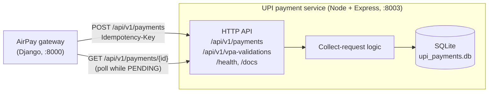
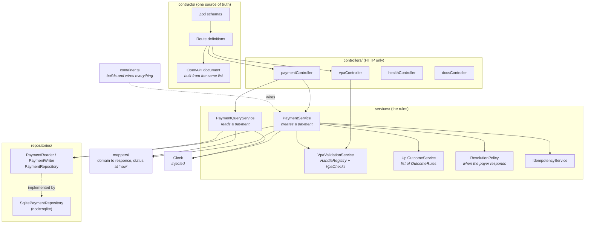
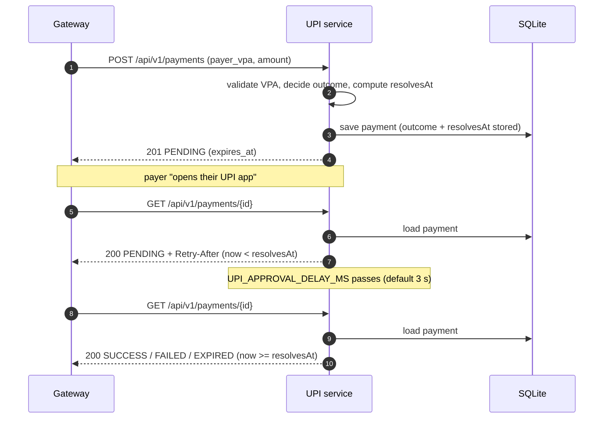
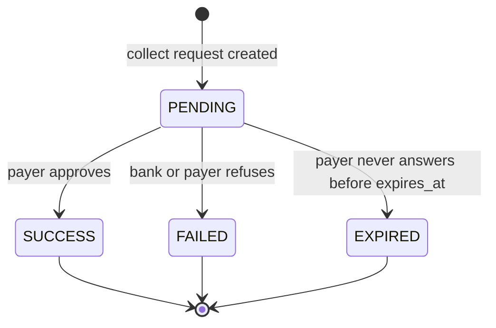
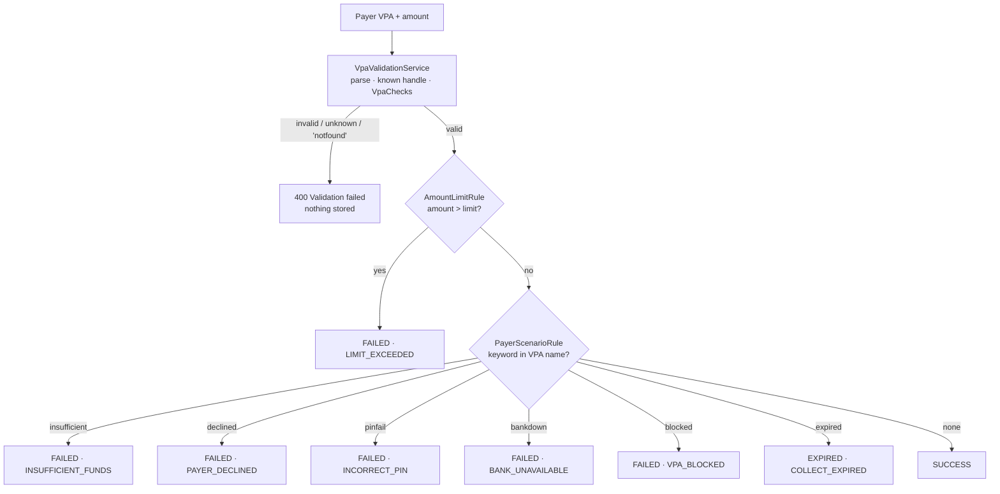
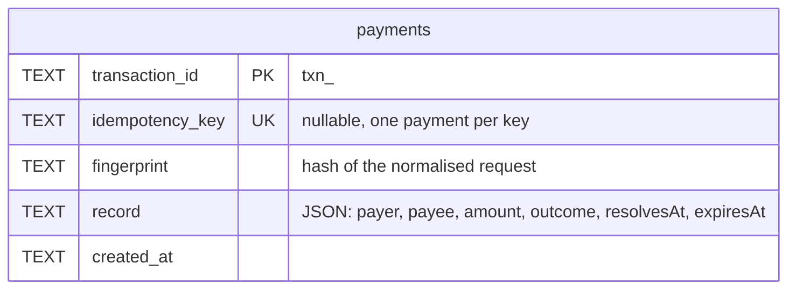

# UPI Payment Service: High-Level Design

This document explains how the service is built and why. For endpoints, configuration and test
VPAs, see the [README](README.md). For how this service fits with the others, see the
[AirPay system README](../README.md).

## 1. What it is

A **mock UPI network, payer's bank and payer's UPI app**, in TypeScript. The AirPay gateway asks it
to start a **collect request** ("please pay this merchant ₹1,500") and later asks how it ended.

UPI collect is **asynchronous**. The payer approves the request in their own app, so the result is
not known when the payment is created. The service therefore answers `201 PENDING` first and
becomes `SUCCESS`, `FAILED` or `EXPIRED` a few seconds later.

No real bank is involved and no money moves.

## 2. Where it sits

Only the gateway calls this service. There is no redirect and no customer-facing page: the payer's
"UPI app" is simulated by the clock.

## 3. How the code is layered

`container.ts` is the only file that names concrete classes. Tests call `buildDependencies` with
their own repository and clock.

## 4. The key idea: decide now, reveal later

A collect request has two moments: it is **created**, and later the payer **responds**. The service
does not run a background job to move a payment from one state to the other. Instead:

1. At **creation** it works out the final outcome (from the payer's VPA and the amount) and the
   time at which the payer "responds" (`resolvesAt`). Both are stored with the payment.
2. At **read** time it compares `now` to `resolvesAt`. Before it, the payment looks `PENDING`.
   After it, the stored outcome is shown.

Why this is good:

- **No timers, no workers.** Nothing needs to wake up and update a row.
- **It survives a restart.** The answer depends only on stored data and the clock.
- **It is deterministic to test.** The `Clock` is injected, so a test moves time forward instead of
  sleeping.

## 5. A payment's life

`PENDING` is the only state that changes. For `EXPIRED`, `resolvesAt` is set to `expires_at`, so the
request only expires after the full timeout. For everything else, `resolvesAt` is the approval delay,
capped at `expires_at`.

## 6. How the outcome is chosen

`UpiOutcomeService` holds a list of `OutcomeRule`s. The first rule that returns an outcome wins. If
none does, the payment succeeds.

Tests choose the result through the payer's VPA, for example `insufficient.funds@okaxis`. Supported
handles are **data** (`HandleRegistry`), so adding `@newbank` is a new row, not new logic.

## 7. Data

One table. The payment, including its stored outcome and `resolvesAt`, is JSON in `record`.

- The status is **not a column** because it is not stored. It is computed from `outcome`,
  `resolvesAt` and the clock when a payment is read.
- The **unique index on `idempotency_key`** makes "one key, one payment" atomic across processes.
- **WAL mode** plus a busy timeout lets a reader and a writer share the file.

## 8. Design approach and why

| Decision | Why |
| --- | --- |
| **Status computed at read time** | Removes background jobs and makes the service restart-safe and easy to test with a fake clock. |
| **Contracts first (Zod to OpenAPI)** | A route's request, response and docs come from one definition. At startup the app fails if a contract has no handler or a handler has no contract, so the spec cannot lie. |
| **Rules as lists** | `OutcomeRule` for outcomes and `VpaCheck` for VPA rules. A new scenario is a new class added in `container.ts`. Existing code does not change. |
| **Handles as data** | Supporting a new UPI handle should not need a code change. |
| **Money as whole paise in `BigInt`** | Floats lose paise. Amounts cross the wire as strings (`"1500.50"`). |
| **Injected `Clock` and `Logger`** | Tests control time. Logs mask VPAs (`ja***@okaxis`), so personal data is not written out. |
| **Reader/writer split** | `PaymentQueryService` only gets a `PaymentReader`, so it cannot change a payment. |
| **Idempotency fingerprint is normalised** | Field order, VPA case and `"10"` against `10.00` mean the same request, so a harmless client difference is not a `409`. |
| **Refuse to start on bad config** | A bad value, or an approval delay longer than the expiry, stops the process with a clear message instead of misbehaving later. |
| **Same conventions as the other rails** | `/api/v1`, snake_case, string amounts, `Idempotency-Key`, `{success, data}` and `{success, message, errors}`. The gateway adapters stay thin. |

## 9. Failure behaviour

| Situation | What happens |
| --- | --- |
| Bad body, unknown field, unknown handle, `notfound` VPA | `400`, nothing stored. |
| Payment still within the approval delay | `GET` returns `PENDING` and a `Retry-After` header. |
| Payer never answers | Becomes `EXPIRED` once `expires_at` passes. |
| Same key, same request | The original payment (`201`, `Idempotent-Replayed: true`) showing its **current** status. |
| Same key, different request | `409`. |
| Two simultaneous requests, same key | One payment. The other replays it. |
| Process restarts | Nothing is lost. State comes from the file and the clock. |
| Body too large | `413`. |
| Unexpected error | `500` with the standard error body, and the stack in the log. |

## 10. Limits

- **It is a mock.** There is no real VPA lookup, no payer app, no callback or webhook to the
  gateway. The gateway must **poll**.
- **Authentication:** none. Keep it on a private network, reachable only by the gateway.
- **No cancel or refund.** A collect request can only end by itself.
- **SQLite** is one file on one host. It fits a mock, not a cluster.
- Because the outcome is fixed at creation, behaviour cannot depend on anything that happens
  *between* creation and response.
