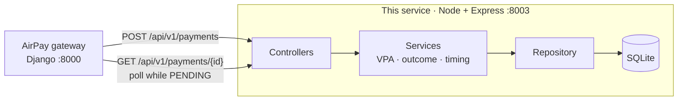

# UPI Payment Service (mock)

A mock UPI service for the AirPay gateway, written in TypeScript. The gateway calls it
to start a UPI **collect request** and to check on it later. There is no real bank behind
it. The outcome of each payment is picked from the payer's VPA, so you can test every case.

It follows the same conventions as `card_payment_service`: `/api/v1` paths, snake_case
fields, string amounts, an `Idempotency-Key` header, and the same success and error
response shapes.

How it is built, and why: [HIGH_LEVEL_DESIGN.md](HIGH_LEVEL_DESIGN.md). How it talks to
the other AirPay services: [system README](../README.md).

## High-level design

UPI collect is **asynchronous**. The payer approves in their own app, so this service
answers `201 PENDING` first and becomes `SUCCESS`, `FAILED` or `EXPIRED` a few seconds
later. There is no customer-facing page: the "UPI app" is the clock.



**How the design is approached.** The service does not run a timer to move a payment
from `PENDING` to a final status. At **create** it already knows the outcome (from the
payer VPA) and the time the payer "responds" (`resolvesAt`). At **read** it compares
`now` to that time. Before it, the payment looks `PENDING`. After it, the stored
outcome is shown.

That choice has three effects: no background workers, the answer survives a restart
(it is just stored data plus the clock), and tests move time forward instead of
sleeping. The `Clock` is injected for that reason.

The rest of the design matches the card service on purpose: controllers, services,
a repository interface, a composition root (`container.ts`), rules as lists
(`OutcomeRule`, `VpaCheck`), money as whole paise in `BigInt`, and contracts (Zod)
as the single source for validation and OpenAPI.

The sequence, the state machine, the data model and the trade-offs are in
[HIGH_LEVEL_DESIGN.md](HIGH_LEVEL_DESIGN.md).

## Run it

You need Node 22.13 or newer (the service uses the built-in `node:sqlite`).

```bash
cd upi_payment_service
npm install
npm run dev          # http://localhost:8003, reloads on change
```

For production-style runs:

```bash
npm run build
npm start
```

Other commands:

| Command | What it does |
| --- | --- |
| `npm test` | Runs the tests |
| `npm run typecheck` | Type-checks the source and tests |
| `npm run openapi` | Writes `openapi.json` from the code |

## API documentation

| URL | What you get |
| --- | --- |
| `http://localhost:8003/docs` | Swagger UI. It is bundled with the service, so it works offline |
| `http://localhost:8003/openapi` | The OpenAPI 3.1 document as JSON (also at `/openapi.json`) |
| `openapi.json` | The same document, committed to the repo |

`/` redirects to `/docs`. A test fails if `openapi.json` is out of date, so after you
change a contract, run `npm run openapi`.

## Endpoints

| Method | Path | Purpose |
| --- | --- | --- |
| `POST` | `/api/v1/payments` | Start a collect request. Returns `201` with status `PENDING` |
| `GET` | `/api/v1/payments/{transaction_id}` | Get the current state. Poll this until the status is final |
| `POST` | `/api/v1/vpa-validations` | Check that a VPA exists and get the holder's name |
| `GET` | `/health` | Health check, with the supported UPI handles |

### How a payment works

UPI collect is asynchronous: the payer approves the request in their own UPI app, so the
result is not known when you create the payment.

```
POST /api/v1/payments  ->  PENDING
                              |
          payer responds (after UPI_APPROVAL_DELAY_MS, default 3 s)
                              |
              SUCCESS  |  FAILED  |  EXPIRED
```

- While the status is `PENDING`, `GET` returns a `Retry-After` header (in seconds).
- A payment that the payer never answers becomes `EXPIRED` once `expires_at` passes.
- The status is worked out from the stored payment and the current time, so no background
  job is needed and the result survives a restart.

### Create a payment

```bash
curl -X POST http://localhost:8003/api/v1/payments \
  -H 'Content-Type: application/json' \
  -H 'Idempotency-Key: order_1001' \
  -d '{
        "amount": "1500.50",
        "payer_vpa": "jane.doe@okaxis",
        "description": "Order 1001",
        "reference": "order_1001"
      }'
```

```json
{
  "success": true,
  "data": {
    "transaction_id": "txn_bd87dbbb-c490-42eb-9ba4-a5dd0954f944",
    "status": "PENDING",
    "amount": "1500.50",
    "currency": "INR",
    "payer": { "vpa": "jane.doe@okaxis", "name": "Jane Doe" },
    "payee": { "vpa": "airpay@okicici", "name": "AirPay Merchant" },
    "rrn": "907497627294",
    "description": "Order 1001",
    "reference": "order_1001",
    "created_at": "2026-10-18T12:13:18.486Z",
    "expires_at": "2026-10-18T12:18:18.486Z"
  }
}
```

Then poll:

```bash
curl http://localhost:8003/api/v1/payments/txn_bd87dbbb-c490-42eb-9ba4-a5dd0954f944
```

After about 3 seconds the status is `SUCCESS` and `completed_at` is set.

### Idempotency

Send an `Idempotency-Key` header (letters, digits, `_` and `-`, up to 255 characters)
to make retries safe.

| You send | You get |
| --- | --- |
| A new key | A new payment (`201`) |
| The same key and the same request | The original payment (`201`) with `Idempotent-Replayed: true`. Its status is the current one |
| The same key and a different request | `409` |
| No key | A new payment every time |

Requests count as the same if they mean the same thing: field order, the case of the VPA,
and `"10"` against `10.00` make no difference.

### Errors

```json
{
  "success": false,
  "message": "Validation failed",
  "errors": [{ "field": "payer_vpa", "message": "VPA does not exist" }]
}
```

| Status | When |
| --- | --- |
| `400` | Invalid body, unknown field, unknown or unsupported VPA, bad `Idempotency-Key`, bad JSON |
| `404` | Unknown transaction or route |
| `409` | `Idempotency-Key` reused with a different request |
| `413` | Body too large |
| `500` | Unexpected error |

## Test scenarios

The outcome comes from the payer VPA. A keyword anywhere in the part before the `@`
picks the scenario. A VPA with no keyword succeeds.

| Payer VPA contains | Final status | `failure_code` |
| --- | --- | --- |
| *(nothing special)* | `SUCCESS` | |
| `insufficient` | `FAILED` | `INSUFFICIENT_FUNDS` |
| `declined` | `FAILED` | `PAYER_DECLINED` |
| `pinfail` | `FAILED` | `INCORRECT_PIN` |
| `bankdown` | `FAILED` | `BANK_UNAVAILABLE` |
| `blocked` | `FAILED` | `VPA_BLOCKED` |
| `expired` | `EXPIRED` (only after the request times out) | `COLLECT_EXPIRED` |
| *amount above the limit* | `FAILED` | `LIMIT_EXCEEDED` |

Examples: `insufficient.funds@okaxis`, `pinfail@ybl`, `expired.user@paytm`.

Other VPA rules:

- A VPA containing `notfound` does not exist, so a payment to it is rejected with `400`
  (and `/vpa-validations` returns `valid: false`).
- Supported handles: `okaxis`, `oksbi`, `okhdfcbank`, `okicici`, `ybl`, `ibl`, `axl`,
  `paytm`, `apl`, `upi`.
- Amounts are from `1.00` to `10000000.00`, with at most 2 decimal places.

## Configuration

Set these as environment variables.

| Variable | Default | Meaning |
| --- | --- | --- |
| `PORT` | `8003` | Port to listen on |
| `UPI_PAYMENT_DB` | `upi_payments.db` in the project folder | SQLite file. Use `:memory:` for a throwaway store |
| `UPI_APPROVAL_DELAY_MS` | `3000` | How long until the payer "responds". Use `0` for instant results |
| `UPI_COLLECT_EXPIRY_SECONDS` | `300` | How long a collect request stays valid |
| `UPI_MERCHANT_VPA` | `airpay@okicici` | The payee VPA on every payment |
| `UPI_MERCHANT_NAME` | `AirPay Merchant` | The payee name |
| `UPI_TRANSACTION_LIMIT` | `100000.00` | Payments above this amount fail with `LIMIT_EXCEEDED` |

The service refuses to start if a value is invalid, or if the approval delay is longer
than the expiry time.

## How the code is organized

```
src/
  contracts/     Zod schemas and routes: one source for validation and the OpenAPI spec
  controllers/   Read the request, call a service, write the response
  services/      Business rules
  repositories/  Storage (SQLite)
  models/        Domain types
  mappers/       Domain <-> response conversion
  middleware/    Error handling
  utils/         Money, VPA, clock helpers
  config.ts      Settings from the environment
  container.ts   Builds every object and wires them together
  app.ts         Express app
  index.ts       Starts the server
```

How the SOLID principles show up:

| Principle | In this service |
| --- | --- |
| Single responsibility | Separate services for VPA validation, deciding the outcome, timing, idempotency, creating payments, and reading payments |
| Open/closed | A new scenario is a new `OutcomeRule`, a new VPA rule is a `VpaCheck`, and a new handle is a row of data. No existing code changes |
| Liskov substitution | The same repository tests run against SQLite and an in-memory version |
| Interface segregation | `PaymentQueryService` only needs a `PaymentReader`, so it cannot write |
| Dependency inversion | Services depend on interfaces (`PaymentRepository`, `Clock`, `Logger`). Only `container.ts` knows the concrete classes |

Other design notes:

- **Money** is handled as whole paise in `BigInt`, never as floats. Amounts go over the
  wire as strings.
- **Contracts** are the single source of truth. At startup the app checks that every
  contract has a handler and every handler has a contract.
- **Storage** is one SQLite table. Idempotency is enforced by a unique index, so two
  requests with the same key at the same moment produce one payment.
- **Time** comes from an injected `Clock`, so tests move time forward without waiting.
- **Logs** mask VPAs (`ja***@okaxis`).
