# System design

This document describes how the Reminders API is built and why. It reflects the
code in this repository.

## 1. Goals and scope

**Goals**

- Let users register and authenticate with email and password.
- Let each user create, read, update, and delete their own reminders.
- Keep the code easy to test and to change by separating HTTP, business rules,
  and data access.

**Out of scope today**

- Sending notifications when a reminder is due. The service stores reminders;
  nothing delivers them.
- Roles, admin accounts, or sharing reminders between users.
- Token revocation and logout (see [Known limitations](#9-known-limitations)).

## 2. System context

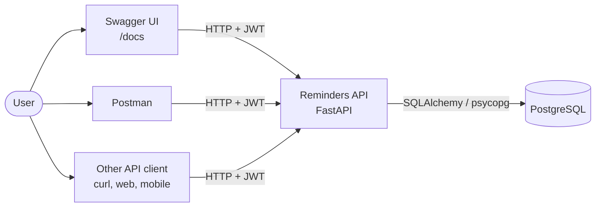

The API is the only component that talks to the database. Clients authenticate
with a JWT sent in the `Authorization: Bearer` header.

## 3. Layered architecture

Each layer depends only on the layer below it.

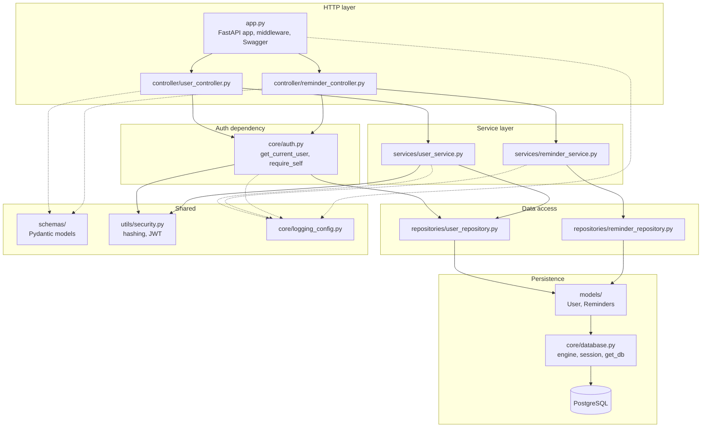

| Layer | Responsibility |
|---|---|
| Controller | Declare routes, validate input with Pydantic, apply auth dependencies, document responses for Swagger |
| Service | Business rules: duplicate email check, ownership check, token issue and refresh, raising `HTTPException` |
| Repository | SQLAlchemy queries and commits. No HTTP concepts |
| Model | Table definitions and relationships |
| `core/auth.py` | Turns a bearer token into the current `User`, or returns 401 |

FastAPI dependency injection wires the layers together. `get_db` yields one
session per request, and `UserService` and `ReminderService` receive it through
their constructors.

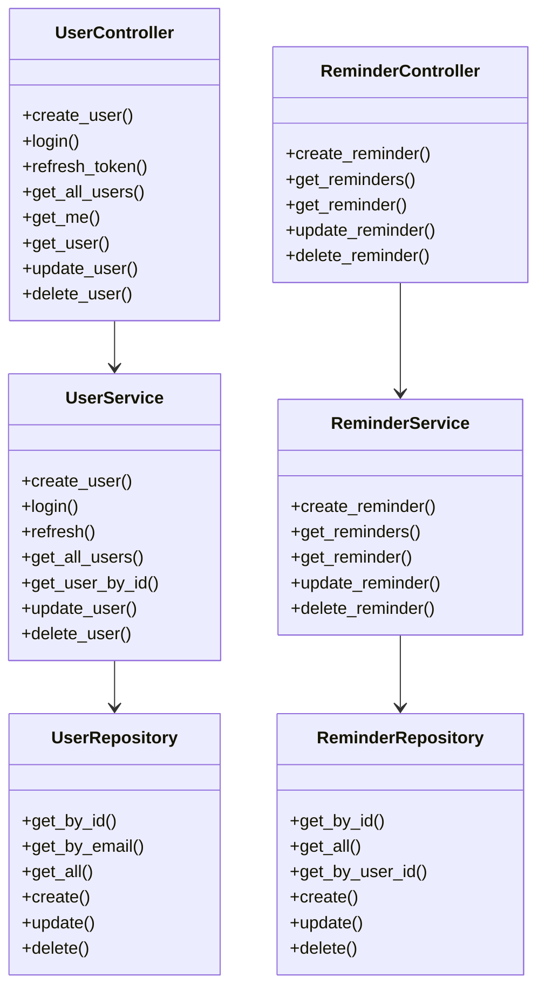

## 4. Data model

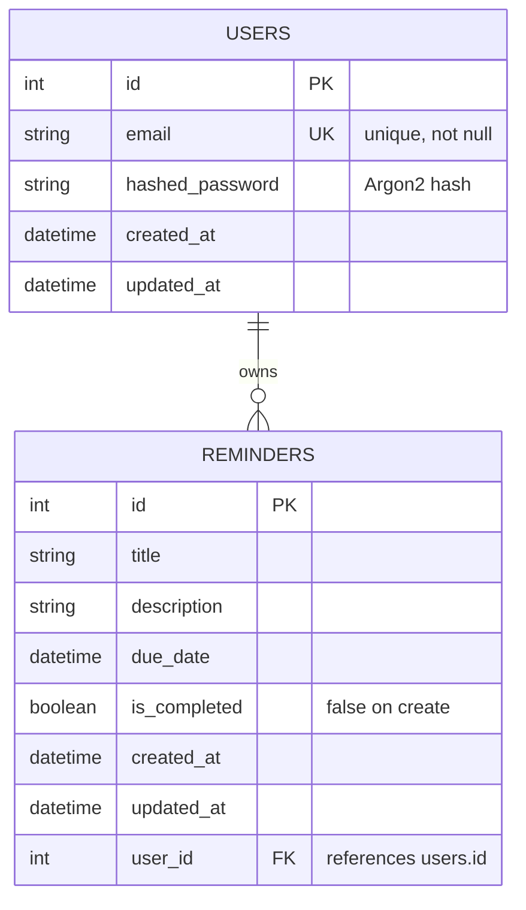

- `created_at` and `updated_at` are set by the repositories, not by database
  defaults.
- The `User.reminders` relationship uses `cascade="all, delete-orphan"`, so
  deleting a user through the ORM deletes their reminders. The foreign key in
  the database has no `ON DELETE CASCADE`, so deleting a user with raw SQL
  would fail while reminders exist.
- Passwords are stored only as Argon2 hashes (`pwdlib`).

## 5. Authentication and authorization

### 5.1 Tokens

| Token | Lifetime | Used for | `type` claim |
|---|---|---|---|
| Access token | 60 minutes (`JWT_EXPIRE_MINUTES`) | `Authorization: Bearer` on protected routes | `access` |
| Refresh token | 7 days (`JWT_REFRESH_EXPIRE_DAYS`) | `POST /users/refresh` only | `refresh` |

Both are HS256 JWTs signed with `JWT_SECRET`, with claims `sub` (user id),
`type`, and `exp`. The decoder checks `type`, so a refresh token cannot call
protected routes and an access token cannot be refreshed.

### 5.2 Register and log in

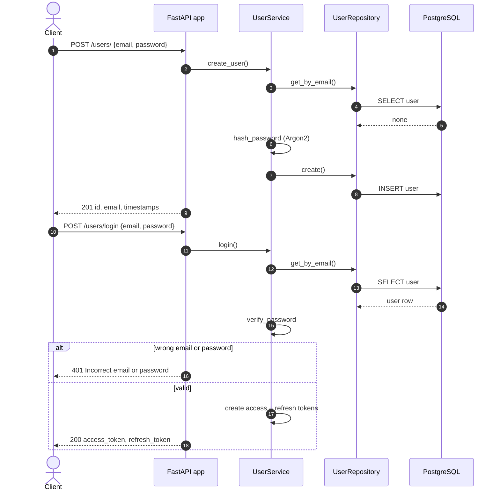

A wrong email and a wrong password return the same 401 message, so the response
does not reveal which emails are registered.

### 5.3 Calling a protected route

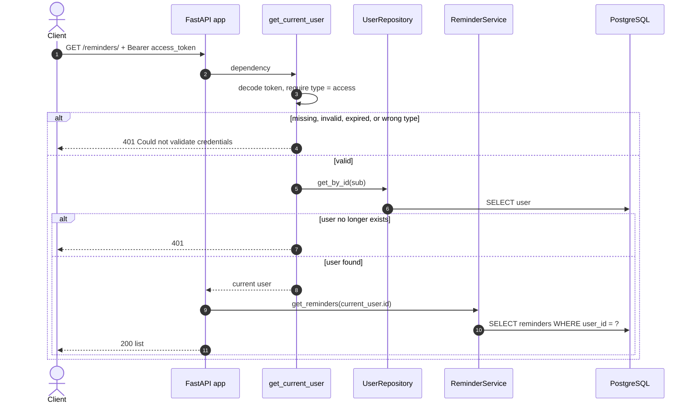

### 5.4 Refreshing tokens

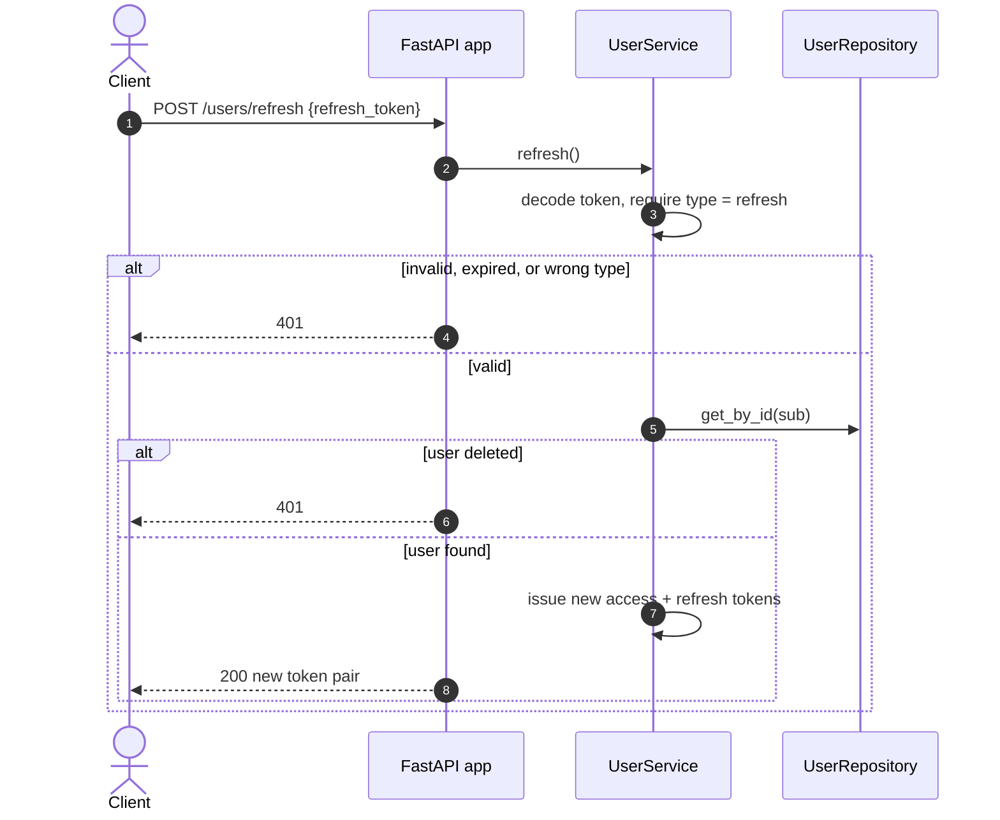

### 5.5 Authorization rules

| Resource | Rule | Failure |
|---|---|---|
| `/users/{user_id}` (get, update, delete) | `current_user.id` must equal `user_id` (`require_self`) | `403` |
| `/reminders/*` | Queries are scoped to `current_user.id`. A reminder owned by someone else is treated as missing | `404` |

Returning `404` for another user's reminder, instead of `403`, avoids confirming
that the reminder id exists.

### 5.6 Token lifecycle

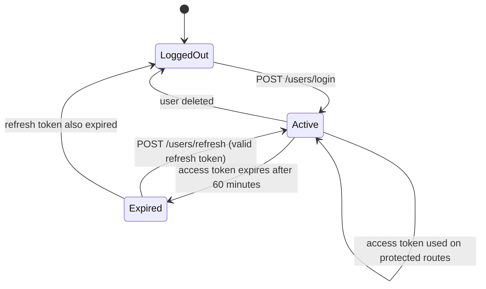

## 6. Request lifecycle and logging

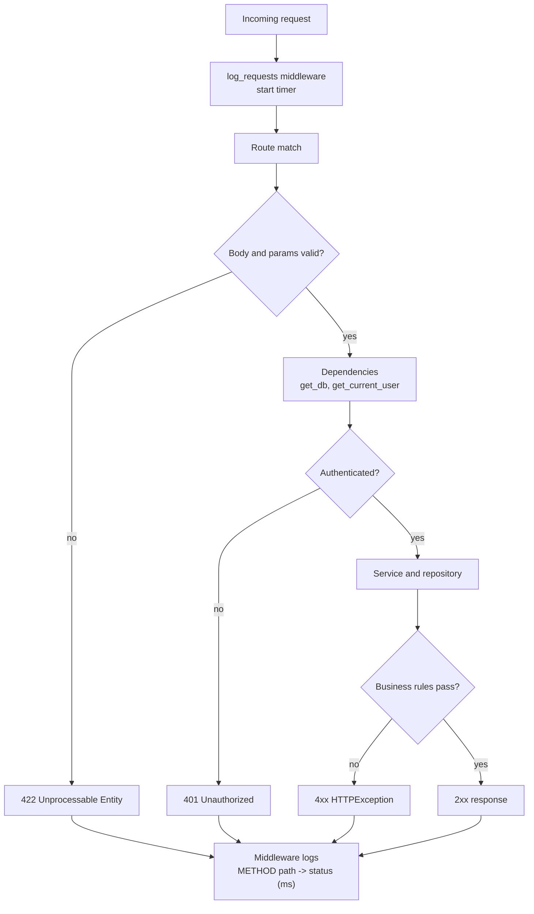

- The middleware writes one line per request to the `reminders.app` logger.
- Services and `core/auth.py` log events at `INFO` (success) and `WARNING`
  (rejections) through `reminders.*` loggers.
- Unhandled exceptions are logged with a stack trace and re-raised.
- Passwords and tokens are never written to logs. Failed logins log only
  "Login failed", not the email or password.

## 7. API surface

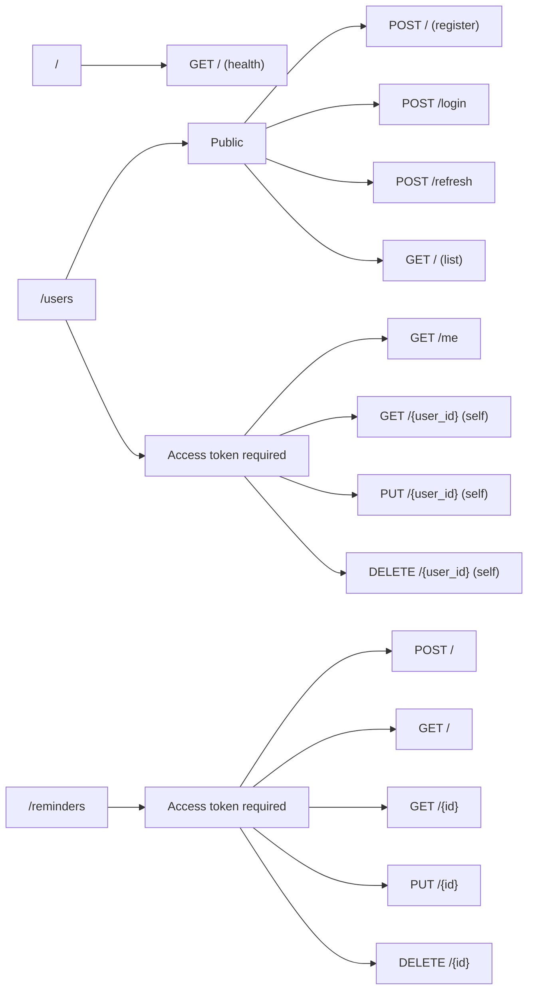

Swagger UI (`/docs`) and ReDoc (`/redoc`) are generated from the route
declarations. The **Authorize** button is backed by the `HTTPBearer` security
scheme in `core/auth.py`.

## 8. Deployment and environments

### 8.1 Local development

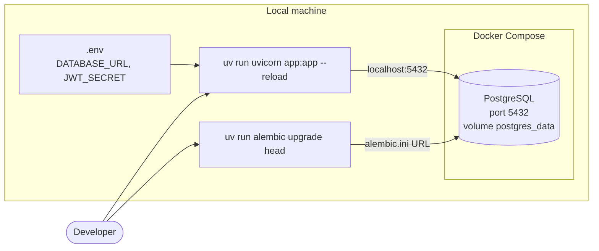

### 8.2 Test and CI flow

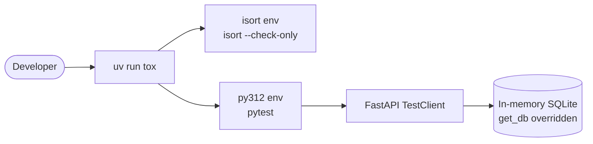

Tests replace the `get_db` dependency with an in-memory SQLite session, so they
run without PostgreSQL. Each test gets a fresh database. The suite covers
registration and login, token types and expiry, refresh, ownership rules,
reminder CRUD and pagination, Swagger availability, and logging.

### 8.3 Configuration

All configuration comes from environment variables (see the README). The same
code runs in every environment; only `DATABASE_URL`, `JWT_SECRET`, token
lifetimes, and `LOG_LEVEL` change.

## 9. Known limitations

These are current behaviors worth knowing before using the service beyond local
development.

| Area | Limitation | Possible improvement |
|---|---|---|
| Token revocation | Tokens are stateless. Refreshing issues a new pair, but the old refresh token stays valid until it expires. There is no logout | Store refresh token ids (`jti`) in the database and rotate or revoke them |
| Default secret | If `JWT_SECRET` is unset, a fixed development key is used | Fail at startup when it is missing outside development |
| Public user list | `GET /users/` needs no token and returns every user's email | Require auth, restrict to admins, or remove it |
| Login abuse | No rate limiting or lockout on `/users/login` | Add rate limiting |
| Migrations URL | `alembic.ini` has its own database URL, separate from `DATABASE_URL` | Read `DATABASE_URL` in `alembic/env.py` |
| Timestamps | `created_at` and `updated_at` use naive local time from the app server | Use timezone-aware UTC |
| Schema | `UserUpdate` requires both email and password, and `ReminderUpdate` replaces all fields (PUT semantics) | Add PATCH endpoints with optional fields |
| Password rules | No minimum length or complexity validation | Add validation to `UserCreate` and `UserUpdate` |
| Deletion | Deleting a user relies on the ORM cascade, not a database `ON DELETE CASCADE` | Add the cascade in a migration |
| Reminders | Reminders are stored but never delivered | Add a scheduler or worker for notifications |
| Test database | Tests run on SQLite, while production uses PostgreSQL | Add a PostgreSQL test job for dialect-specific behavior |

## 10. Key decisions

| Decision | Reason |
|---|---|
| Controller, service, and repository layers | Keeps routes thin and lets business rules and queries be tested and changed on their own |
| JWT access token plus refresh token | Short-lived access tokens limit exposure, and refresh tokens avoid asking for the password again |
| `type` claim on tokens | Prevents one token kind from being used where the other is expected |
| Argon2 via `pwdlib` | Current recommended password hashing, with a built-in salt |
| `404` for other users' reminders | Does not reveal which reminder ids exist |
| SQLite for tests via dependency override | Fast, isolated tests with no external services |
| uv with a locked environment, plus tox | Reproducible installs locally and in CI |
